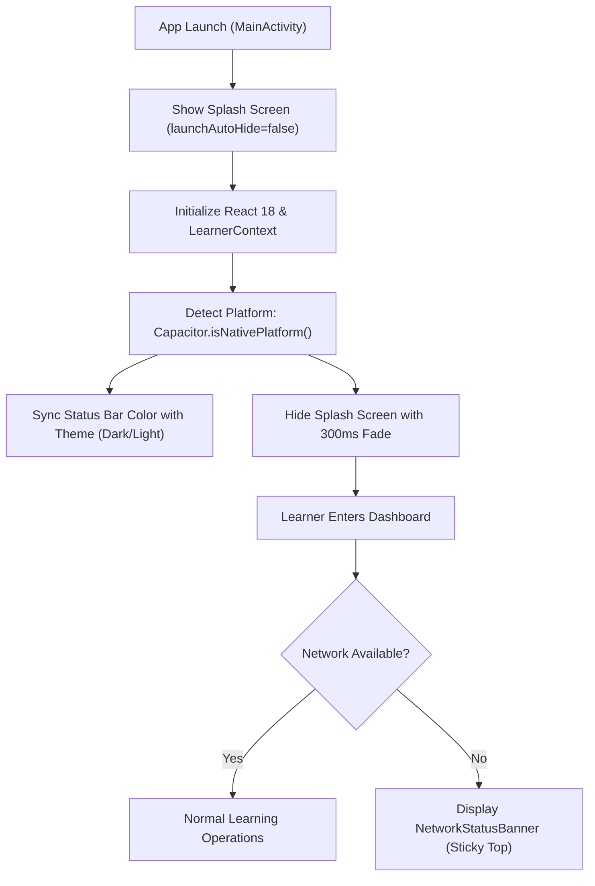

# AIIMS Android Device Permissions & Plugins Documentation

This document provides a comprehensive audit of all Android permissions, Capacitor plugins, native device capabilities, runtime behaviors, and security configurations implemented for the AIIMS Mobile Application.

---

## 1. Android Permissions Audit

AIIMS strictly follows the **Principle of Least Privilege (PoLP)**. The Android application declares and utilizes only the single permission strictly necessary to communicate with the AIIMS backend APIs and learning services.

### Declared Manifest Permissions

| Permission | Protection Level | Purpose / Justification | Runtime Consent Required? |
| :--- | :--- | :--- | :--- |
| `android.permission.INTERNET` | Normal | Required for HTTPS network communication with AIIMS Backend APIs (`/api`), authentication endpoints, real-time assessment scoring, and question sync. | No (Granted automatically by Android at install time) |

### Zero Unnecessary Permissions Policy
The application intentionally **does not** request or declare any dangerous or sensitive permissions, ensuring zero privacy intrusion:
- **No Camera (`android.permission.CAMERA`):** Not required; AI task lab and prompt interactions are text- and data-driven.
- **No Location (`ACCESS_FINE_LOCATION`, `ACCESS_COARSE_LOCATION`):** Not required; user geolocation is not collected or tracked.
- **No Storage / Media (`READ_EXTERNAL_STORAGE`, `WRITE_EXTERNAL_STORAGE`):** Not required; user state and tokens are held in-memory and in secure application sandbox storage.
- **No Contacts / Accounts (`READ_CONTACTS`, `GET_ACCOUNTS`):** Not required; all authentication is handled via AIIMS JWT tokens.
- **No Telephony / Device Identifiers (`READ_PHONE_STATE`):** Not required; device identification uses privacy-preserving pseudonymous client-generated UUIDs stored in the app sandbox.

---

## 2. Capacitor Plugins & Configurations

The AIIMS Android application integrates official Capacitor 6 plugins to bridge web functionality with native Android OS capabilities.

### 2.1 `@capacitor/app` (v6.0.3)
- **Purpose:** Native application lifecycle management and hardware button handling.
- **Integration Location:** [`Frontend/src/App.tsx`](file:///c:/Users/divya/OneDrive/Documents/AIIMS/Frontend/src/App.tsx)
- **Features Implemented:**
  - **Hardware Back Button Handling:** Registers an `appBackButton` listener to provide a predictable 4-tier navigation hierarchy:
    1. **Active Modal / Dialog:** Closes top-level dialogs (e.g., confirmation modals, inspection overlays).
    2. **Active Non-Home Screen:** Navigates back to `'home'` dashboard when the user is in Clarity, Focus, Wallet, or Journey.
    3. **Sub-Task / Lab Mode:** When within Level 2 AI Task Lab, returns the learner to the task selection overview.
    4. **Root Home Screen Exit:** Calls `CapacitorApp.exitApp()` to cleanly minimize/close the application when already at the home root.
  - **App State Listeners:** Monitors app foreground/background transitions to pause active Focus Pomodoro timers when backgrounded.

### 2.2 `@capacitor/status-bar` (v6.0.3)
- **Purpose:** Dynamic native status bar styling coordinated with AIIMS Theme tokens.
- **Integration Location:** [`Frontend/src/App.tsx`](file:///c:/Users/divya/OneDrive/Documents/AIIMS/Frontend/src/App.tsx)
- **Features Implemented:**
  - **Dark Mode Synchronization:**
    - Dark Mode (`isDarkMode === true`): Sets style to `Style.Dark`, background color to `#0B0F19` (AIIMS Navy token), and overlay false.
    - Light Mode (`isDarkMode === false`): Sets style to `Style.Light`, background color to `#FFFFFF` (Surface pure token), and overlay false.
  - **Safe Execution Guard:** Wrapped in `Capacitor.isNativePlatform()` check to ensure zero breakage or console errors when executed in web browsers.

### 2.3 `@capacitor/splash-screen` (v6.0.4)
- **Purpose:** Control over native application launch splash screen.
- **Integration Location:** [`Frontend/src/App.tsx`](file:///c:/Users/divya/OneDrive/Documents/AIIMS/Frontend/src/App.tsx) & `capacitor.config.ts`
- **Features Implemented:**
  - **Auto-Hide Disabled:** `launchAutoHide: false` configured in `capacitor.config.ts` to prevent premature flash of unstyled content during bundle boot.
  - **Programmatic Hide:** Invoked via `SplashScreen.hide({ fadeOutDuration: 300 })` only after React context, learner profile, and theme initialization complete.
  - **Configured Durations:** Fallback launch show duration configured to 2000ms with smooth 300ms fade-out transition.

---

## 3. Native Device Features & Web Resilience

### 3.1 Network Connectivity & Offline Resilience (`NetworkStatusBanner.tsx`)
- **Integration Location:** [`Frontend/src/components/common/NetworkStatusBanner.tsx`](file:///c:/Users/divya/OneDrive/Documents/AIIMS/Frontend/src/components/common/NetworkStatusBanner.tsx)
- **Detection Mechanism:** Subscribes to browser/WebView `online` and `offline` window events.
- **UI Presentation:**
  - **Offline State:** Sticky top alert banner with high-contrast warning icon, alerting the learner that network connectivity has been lost and cached content is being viewed.
  - **Reconnection State:** Automatic success feedback ("Back online. Synchronizing data...") when connectivity is restored, featuring a manual "Retry Connection" action button.
  - **Accessibility:** Configured with `role="status"` and `aria-live="polite"` for screen readers.

### 3.2 Viewport & Safe Area Management
- **Integration Location:** [`Frontend/index.html`](file:///c:/Users/divya/OneDrive/Documents/AIIMS/Frontend/index.html) & CSS tokens
- **Viewport Meta:**
  ```html
  <meta name="viewport" content="width=device-width, initial-scale=1.0, maximum-scale=1.0, user-scalable=no, viewport-fit=cover" />
  ```
- **Safe Area Insets:** Handled via CSS environment variables:
  - `padding-top: env(safe-area-inset-top, 0px);` (protects status bar and camera cutouts).
  - `padding-bottom: env(safe-area-inset-bottom, 0px);` (protects Android navigation bar and gesture pill).

### 3.3 Touch Targets & Responsive Layouts
- All touch targets across Mobile Navigation tabs, action buttons, timer toggles, and answer options enforce minimum dimensions of **44×44px** in accordance with WCAG 2.1 AA and Google Material Design guidelines.
- Responsive breakpoints verified across standard mobile form factors (360×800, 375×812, 390×844, 412×915, 768×1024 tablet).

---

## 4. Runtime Permission Flow & Zero-Prompt UX

Because AIIMS declares solely `android.permission.INTERNET`, no runtime permission dialogs (e.g., `requestPermissions()`) interrupt the learner experience. The user opens the app, views the branded splash screen, and immediately transitions into the authenticated learner dashboard without friction.



