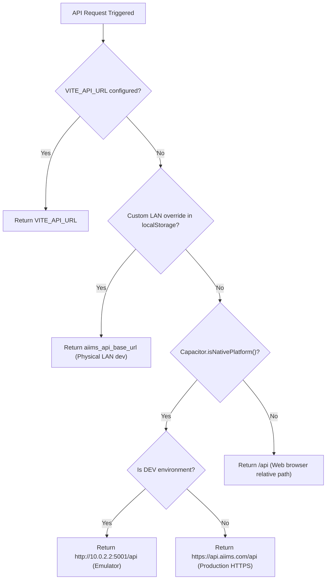
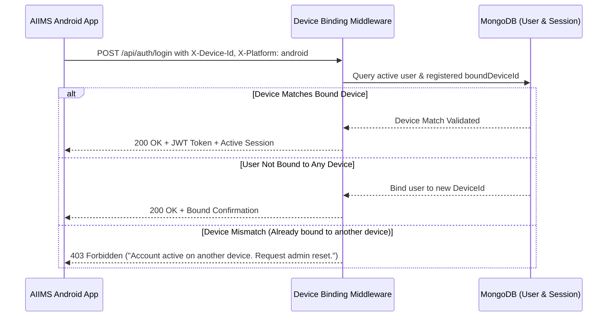

# AIIMS Android Security & API Configuration

This document specifies the network security, API client resolution, token management, hardware binding headers, and mobile application hardening implemented for the AIIMS Android mobile client.

---

## 1. Network Security Architecture

AIIMS enforces strict cryptographic and network communication controls between the Android native WebView and backend services.

### 1.1 Cleartext Traffic Policy (Dev vs. Production)
- **Production Standard:** In production releases, cleartext HTTP communication is prohibited. All endpoints must communicate over TLS 1.3/1.2 (`https://api.aiims.com/api`).
- **Development & Emulator Bridging:**
  - Standard Android emulators cannot resolve `localhost` directly to the host machine. Instead, Android provides the loopback alias `10.0.2.2`.
  - In development environments, the API client dynamically falls back to `http://10.0.2.2:5001/api` when `Capacitor.isNativePlatform()` is detected and no custom LAN override is specified.
  - Physical devices on a local area network can override the target endpoint via `setCustomApiBaseUrl(url)` stored in `localStorage.getItem('aiims_api_base_url')`.

### 1.2 Capacitor Configuration (`capacitor.config.ts`)
```typescript
import type { CapacitorConfig } from '@capacitor/cli';

const config: CapacitorConfig = {
  appId: 'com.aiims.app',
  appName: 'AIIMS',
  webDir: 'dist',
  server: {
    androidScheme: 'https',
    cleartext: false, // Disallows insecure traffic in production builds
  },
  plugins: {
    SplashScreen: {
      launchShowDuration: 2000,
      launchAutoHide: false,
      backgroundColor: '#0B0F19',
      androidSplashResourceName: 'splash',
      showSpinner: false,
    },
    StatusBar: {
      overlaysWebView: false,
      style: 'DARK',
      backgroundColor: '#0B0F19',
    },
  },
};

export default config;
```

---

## 2. Dynamic API Base URL Resolution

The AIIMS API client provides deterministic, environment-aware endpoint resolution in [`Frontend/src/api/client.ts`](file:///c:/Users/divya/OneDrive/Documents/AIIMS/Frontend/src/api/client.ts).

### Resolution Algorithm (`getApiBaseUrl()`)


### 2.1 Request Timeout Protection
Mobile connections can experience sudden signal degradation or cell tower handoffs. To avoid hanging UI threads, all API requests via `apiFetch` in `client.ts` enforce an **AbortController timeout of 15 seconds (15,000ms)**. If a request times out, it aborts cleanly and surfaces a user-friendly connectivity notification.

---

## 3. Token & State Storage in Mobile Context

### 3.1 JWT Storage & Memory Boundaries
- Access tokens are received upon successful login/verification and stored securely within the browser's application sandbox storage (`localStorage`).
- In the native Android wrapper, WebView local storage is scoped entirely to the private application directory (`/data/data/com.aiims.app/app_webview/Local Storage/`) with Unix permissions restricting access to the application UID only.
- In-memory state synchronization occurs via `LearnerContext.tsx`, maintaining current credit balance, active focus session state, and diagnostic scores in memory during the app lifecycle.

### 3.2 Anti-Data Leakage Android Manifest Directives
The Android application manifest [`AndroidManifest.xml`](file:///c:/Users/divya/OneDrive/Documents/AIIMS/Frontend/android/app/src/main/AndroidManifest.xml) enforces essential application security hardening:
- `android:allowBackup="false"`: Prevents adb backup extraction of app private storage, auth tokens, and session databases.
- `android:exported="true"`: Limited strictly to `MainActivity` with the `MAIN` launcher intent filter. All internal receivers, providers, and services are unexported (`android:exported="false"`).
- `FileProvider`: Configured with `android:exported="false"` and `android:grantUriPermissions="true"`.

---

## 4. Mobile Device Identification & One Account – One Device Binding

AIIMS implements strict device authentication enforcing that an account may only be actively used on a single registered device at a time. The Android application satisfies this via seamless mobile hardware headers.

### 4.1 Mobile Device Headers
Every outbound API request from the mobile application automatically attaches standard device binding headers:
1. `X-Device-Id`: A stable pseudonymous client UUID stored in application private storage (`aiims_device_id`).
2. `X-Platform`: Transmits `'android'` when running inside the Capacitor Android native wrapper, `'web'` otherwise.
3. `X-Device-Name`: Identifies the device model (e.g., `'Android Mobile Device'`).

### 4.2 Backend Device Verification Flow


---

## 5. Offline Handling & Data Resilience

1. **Active Offline Banner:**
   - The `<NetworkStatusBanner />` component continuously monitors network reachability.
   - When offline, destructive or balance-mutating actions (e.g., claiming credit rewards, submitting assessment answers) are gracefully disabled to avoid inconsistent client-server state.
2. **Local Session Continuity:**
   - Active focus session timers continue uninterrupted during temporary network dropouts; when connection is re-established, completion results synchronize back to the backend.
3. **Idempotency Safeguards:**
   - All balance updates utilize the idempotency ledger (`CreditLedger`), ensuring that any re-attempted requests after a mobile connection drop do not result in duplicate credit deductions or awards.

