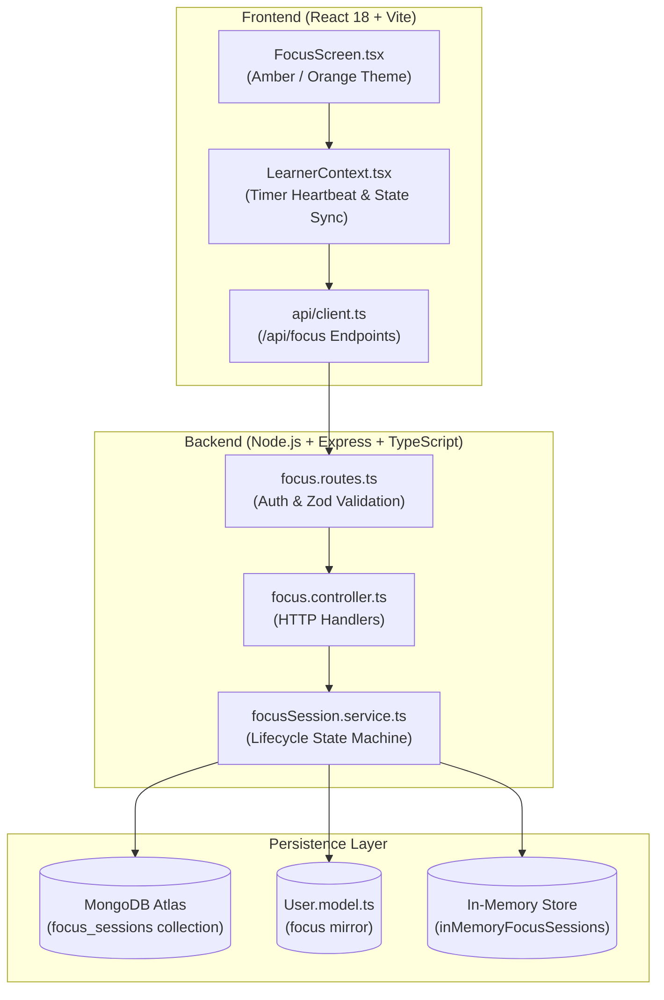

# AIIMS Focus Module Architecture Document

## Executive Overview

The **AIIMS Focus Module** is a core learning component designed to provide learners with structured, distraction-free concentration intervals, restorative breaks, and progress tracking. It adheres to strict server-authoritative timekeeping, multi-device session coherence, single-active-session concurrency protection, and complete separation between focus intervals and break periods.

---

## 1. Architectural Principles

### 1.1 Authoritative Server Timekeeping
- **Single Source of Truth:** Timer deadlines, elapsed seconds, paused intervals, and completion qualifications are calculated and verified authoritatively by the backend.
- **Client Clock Manipulation Defense:** Clients send only lifecycle action commands (`start`, `pause`, `resume`, `complete`, `abandon`). The server calculates elapsed durations using server timestamps (`startedAt`, `pausedAt`, `targetEndTime`, `completedAt`).
- **Resilience to Backgrounding & Throttling:** Rather than relying on fragile browser `setInterval` ticks which drift when backgrounded or throttled, client countdowns dynamically interpolate against the server's persisted target epoch timestamp (`targetEndTime`).
- **Anti-Tampering Guard:** Learners cannot claim completion early. Sessions attempting completion with remaining time exceeding the 5-second completion tolerance are rejected with HTTP 400 (`FOCUS_DURATION_INCOMPLETE`).

### 1.2 Single Active Session Guarantee
- An account is permitted exactly one active or paused focus/break session at any point in time across all devices and tabs.
- Calling `POST /api/focus/start` while an existing session is in `focusing`, `paused`, or `break` state returns the existing active session (`isExisting: true`), preventing duplicate sessions, parallel duration farming, or race conditions.

### 1.3 Strict Separation of Focus and Break Durations
- **Break Time Isolation:** Time spent in short breaks or long breaks is tracked in `totalBreakSeconds` and strictly excluded from focus time calculations.
- **Completed Focus Integrity:** Focus statistics (`todayFocusSeconds`, `todayFocusHours`, `totalCompletedSessions`) count only completed focus periods.
- **No Credit / Money Farming:** In accordance with AIIMS architectural rules, the Focus Module operates purely as a concentration and workflow habit tool without unverified money-like credit inflation or unconfirmed streak rewards.

---

## 2. Component Architecture



---

## 3. Data Models & Schemas

### 3.1 FocusSession Schema (`Backend/src/models/FocusSession.model.ts`)
```typescript
export interface IFocusSession extends Document {
  sessionId: string;
  learnerId: string;
  trackTitle: string;
  intention?: string;
  sessionState: 'idle' | 'focusing' | 'paused' | 'break' | 'completed' | 'abandoned';
  periodType: 'focus' | 'short_break' | 'long_break';
  status: 'in_progress' | 'completed' | 'abandoned';
  focusDurationMinutes: number;        // 1 to 180 (presets: 15, 25, 45, 60)
  breakDurationMinutes: number;        // 1 to 60 (presets: 3, 5, 10)
  longBreakDurationMinutes: number;   // 1 to 60 (default: 15)
  longBreakInterval: number;          // 1 to 12 (default: 4)
  enableLongBreak: boolean;           // default: true
  soundEnabled: boolean;              // default: true
  totalPeriodSeconds: number;
  remainingSeconds: number;
  accumulatedFocusSeconds: number;
  totalBreakSeconds: number;
  completedCycles: number;
  startedAt: Date;
  pausedAt: Date | null;
  targetEndTime: Date | null;
  completedAt: Date | null;
  createdAt: Date;
  updatedAt: Date;
}
```

### 3.2 Database Indexes
- `{ sessionId: 1 }` (unique)
- `{ learnerId: 1, status: 1 }` (fast active session lookups)
- `{ learnerId: 1, startedAt: -1 }` (fast history retrieval)
- `{ learnerId: 1, sessionState: 1 }` (state filtering)

---

## 4. API Endpoints Specification

| Method | Endpoint | Description | Auth Required |
|---|---|---|---|
| `GET` | `/api/focus/active` | Retrieve current active focus or break session | Yes (Bearer/Cookie) |
| `POST` | `/api/focus/start` | Start focus session (or return existing active session) | Yes (Bearer/Cookie) |
| `POST` | `/api/focus/pause` | Pause active focusing or break session | Yes (Bearer/Cookie) |
| `POST` | `/api/focus/resume` | Resume paused session with recalculated target deadline | Yes (Bearer/Cookie) |
| `POST` | `/api/focus/complete` | Authoritatively verify elapsed time & mark completed | Yes (Bearer/Cookie) |
| `POST` | `/api/focus/break` | Start short or long break interval | Yes (Bearer/Cookie) |
| `POST` | `/api/focus/abandon` | Terminate session prematurely (history saved if $\ge 30$s) | Yes (Bearer/Cookie) |
| `GET` | `/api/focus/stats` | Server-calculated daily and lifetime statistics | Yes (Bearer/Cookie) |
| `GET` | `/api/focus/history` | Paginated/filtered historical session records | Yes (Bearer/Cookie) |
| `PUT` | `/api/focus/config` | Update duration & sound configuration preferences | Yes (Bearer/Cookie) |

