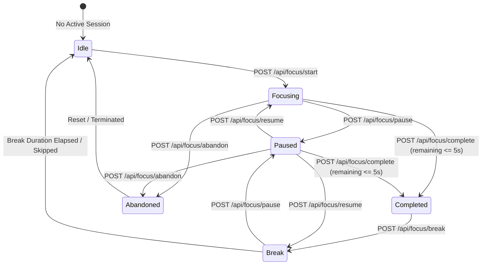

# AIIMS Focus Session Lifecycle & Timekeeping Specification

## 1. Lifecycle State Machine

The AIIMS Focus Module enforces a deterministic finite-state machine (FSM) across every focus session:

---

## 2. State & Period Definitions

| State | Period Type | Description | Target End Time | Remaining Seconds |
|---|---|---|---|---|
| `idle` | `null` | No active session for learner | `null` | Defaults to configured preset |
| `focusing` | `focus` | Active concentration interval | Active Epoch Timestamp | Dynamically calculated |
| `paused` | `focus` / `break` | Frozen timer; focus accumulation halted | `null` (frozen) | Frozen at moment of pause |
| `break` | `short_break` / `long_break` | Restorative break period | Active Epoch Timestamp | Dynamically calculated |
| `completed` | `focus` | Target duration met & cycle counted | `null` | `0` |
| `abandoned` | `focus` | Terminated prior to completion | `null` | `0` |

---

## 3. Mathematical Timekeeping Specifications

### 3.1 Session Start Math
Upon `POST /api/focus/start`:
$$\text{durationSeconds} = \text{focusDurationMinutes} \times 60$$
$$\text{startedAt} = \text{now}_{\text{server}}$$
$$\text{targetEndTime} = \text{startedAt} + (\text{durationSeconds} \times 1000)$$
$$\text{accumulatedFocusSeconds} = 0$$
$$\text{remainingSeconds} = \text{durationSeconds}$$

### 3.2 Dynamic Countdown Calculation
During `focusing` or `break`, client and server compute remaining time from epoch timestamps:
$$\text{remainingSeconds} = \max\left(0, \left\lceil \frac{\text{targetEndTime} - \text{now}}{1000} \right\rceil\right)$$
This formula guarantees that browser tab throttling, mobile backgrounding, or device sleep never cause timer loss or drift.

### 3.3 Pause Freezing Math
Upon `POST /api/focus/pause`:
1. Calculate frozen remaining seconds:
   $$\text{remainingSeconds} = \max\left(0, \left\lceil \frac{\text{targetEndTime} - \text{now}}{1000} \right\rceil\right)$$
2. Accumulate active focus time if in focus period:
   $$\text{elapsed} = \max(0, \text{totalPeriodSeconds} - \text{remainingSeconds})$$
   $$\text{accumulatedFocusSeconds} = \max(\text{accumulatedFocusSeconds}, \text{elapsed})$$
3. Freeze timestamps:
   $$\text{targetEndTime} = \text{null}$$
   $$\text{pausedAt} = \text{now}_{\text{server}}$$
   $$\text{sessionState} = \text{'paused'}$$

### 3.4 Resume Math
Upon `POST /api/focus/resume`:
$$\text{targetEndTime} = \text{now}_{\text{server}} + (\text{remainingSeconds} \times 1000)$$
$$\text{pausedAt} = \text{null}$$
$$\text{sessionState} = (\text{periodType} = \text{'focus'} \; ? \; \text{'focusing'} : \text{'break'})$$

### 3.5 Completion Qualification Guard
Upon `POST /api/focus/complete`:
- If $\text{remainingSeconds} > 5$ seconds: **REJECTED with HTTP 400 (`FOCUS_DURATION_INCOMPLETE`)**.
- If $\text{remainingSeconds} \le 5$ seconds:
  $$\text{completedCycles} = \text{completedCycles} + 1$$
  $$\text{completedAt} = \text{now}_{\text{server}}$$
  $$\text{status} = \text{'completed'}$$
  $$\text{sessionState} = \text{'completed'}$$
  $$\text{accumulatedFocusSeconds} = \text{totalPeriodSeconds}$$

---

## 4. Break Rotation & Intervals

1. **Short Break:** Default 5 minutes (presets: 3m, 5m, 10m; custom: 1–60m).
2. **Long Break:** Default 15 minutes (custom: 1–60m).
3. **Long Break Trigger Condition:**
   $$\text{isLongBreak} = \text{enableLongBreak} \land (\text{completedCycles} > 0) \land (\text{completedCycles} \pmod{\text{longBreakInterval}} = 0)$$
   Default `longBreakInterval` is 4 cycles.
4. **Data Isolation:** Break time is accumulated separately in `totalBreakSeconds`. Break seconds never add to focus statistics or completed focus hours.

---

## 5. Abandonment Thresholds & Exclusion Policy

- **Instant Cancel Guard ($< 30$ seconds):**
  - If a session is abandoned with less than 30 seconds of active concentration, it is treated as accidental or discarded noise.
  - It is removed from the database and **never** appended to `sessionHistory`.
- **Partial Session Logging ($\ge 30$ seconds):**
  - If a session is abandoned after $\ge 30$ seconds of focus, it is recorded in `sessionHistory` with `status: 'abandoned'`.
  - It provides learners with personal records of partial work.
- **Statistical Exclusion:**
  - Abandoned sessions **never** increment `todayCompletedSessions` or `totalCompletedSessions`.
  - Abandoned seconds **never** add to `todayFocusSeconds` or `todayFocusHours`.

