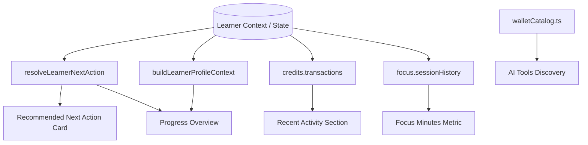

# AIIMS Home Dashboard Architecture

## 1. Overview & Architectural Principles
The **AIIMS Home Dashboard** (`Frontend/src/screens/home/HomeScreen.tsx`) serves as the central command center for every learner. Designed according to strict authoritative data binding principles, the Home Dashboard strictly reflects verified server-side state from `LearnerContext` and the canonical `resolveLearnerNextAction` engine.

### Architectural Invariants:
1. **Zero Hallucinated Progress:** A newly registered learner with 0 completed assessments displays strictly 0% progress and 0 completed milestones.
2. **Authoritative Metric Binding:** Metrics (Credit balance, XP, diagnostic evaluation score, Clarity progression, today focus minutes) directly bind to actual state collections; no placeholder random numbers or fake completions.
3. **Canonical 10-Stage Roadmap Alignment:** The journey stages in Home mirror the canonical 10-stage curriculum defined across `featureAccessService.ts` and `journeyResolver.ts`.
4. **Verified Tool Grounding:** AI Tool recommendations derive directly from `getWalletCatalog()` in `walletCatalog.ts`.

---

## 2. Seven Essential Dashboard Sections

```
+-------------------------------------------------------------------------+
| SECTION 1: WELCOME BANNER                                               |
| - Dynamic time-aware greeting ("Good morning, Priya")                   |
| - Stage pill badge ("Stage: Knowing" / "Explorer")                      |
| - Dynamic context date & summary tagline                                |
+-------------------------------------------------------------------------+
| SECTION 2: LEARNING PROGRESS OVERVIEW (6 METRIC TILES)                  |
| [ Journey Progress ] [ Milestones Done ] [ Current Stage ]              |
| [ Clarity Level    ] [ Diagnostic Score] [ Today's Focus ]              |
+-------------------------------------------------------------------------+
| SECTION 3: RECOMMENDED NEXT ACTION                                      |
| - Authoritative single best step from resolveLearnerNextAction()        |
| - Clear evidence-backed rationale & high-visibility CTA                 |
+-------------------------------------------------------------------------+
| SECTION 4: CONTINUE LEARNING (IN-FLIGHT MODULE)                         |
| - Dynamic continuation target based on current learner state            |
+-------------------------------------------------------------------------+
| SECTION 5: QUICK ACCESS GRID (9 CORE MODULES)                           |
| [ Clarity ] [ Focus ] [ AI Wallet ] [ Tool Match ] [ Journey ]          |
| [ Assessment History ] [ AI Radar ] [ Universe ] [ Problem Solver ]     |
+-------------------------------------------------------------------------+
| SECTION 6: RECENT LEARNING ACTIVITY (TRANSACTIONS / LEDGER)             |
| - Chronological ledger entries or honest EmptyState illustration        |
+-------------------------------------------------------------------------+
| SECTION 7: AI TOOLS DISCOVERY (VERIFIED CATALOG)                        |
| - 3 Verified tools from getWalletCatalog() (ChatGPT, Claude, Cursor)   |
| - Capability tags, pricing model badge, and direct modal exploration   |
+-------------------------------------------------------------------------+
```

### Section 1: Welcome Banner
- **Dynamic Personalization:** Extracts learner first name from `state.profile.name` (falling back to "Learner" if anonymous).
- **Stage Badge:** Reflects current cognitive stage (`state.profile.stage` or derived stage).
- **Time-Aware Greeting:** Dynamically selects "Good morning", "Good afternoon", or "Good evening" using client clock.

### Section 2: Learning Progress Overview
Displays 6 primary progress indicators styled with AIIMS Design System tokens:
1. **Overall Journey Progress:** Percentage bar (`LinearProgress`) representing canonical milestones completed out of 10.
2. **Completed Milestones:** Exact count of completed stages (`X / 10 Milestones`).
3. **Current Learning Stage:** Label of the active stage (e.g., "Understand AI", "My AI Profile").
4. **Clarity Progression:** Current task difficulty or completion count (`Level 1` / `Easy` / `X tasks completed`).
5. **Diagnostic Baseline:** Evaluated overall diagnostic score (`8.5/10` or "Pending Baseline").
6. **Focus Concentration:** Verified minutes focused today (`X mins today` across completed sessions).

### Section 3: Recommended Next Action
- Consumes `resolveLearnerNextAction(state)`.
- Presents current stage title, next action title, and plain-English rationale.
- Action button executes `onNavigate(nextAction.targetTab)` to route the user instantly to their next milestone.

### Section 4: Continue Learning
- Evaluates in-flight tasks (e.g., active Focus session, incomplete Clarity reflections, or pending diagnostic).
- Provides immediate one-click resumption.

### Section 5: Quick Access Navigation Grid
Features 9 core functional modules formatted into responsive interactive cards:
1. **Clarity Tasks:** Prompt engineering & task decomposition lab (`clarity`).
2. **Focus Sessions:** Pomodoro & concentration timer (`focus`).
3. **AI Wallet:** Credit balance, transaction ledger, and tool ownership (`wallet`).
4. **Tool Matching:** Intelligent AI search & recommendation engine (`wallet` / matching).
5. **My AI Journey:** Comprehensive 10-stage learning roadmap (`journey`).
6. **Assessment History:** Chronological attempts and diagnostic records (`history`).
7. **AI Radar:** Real-time AI capability signals (`radar`).
8. **Learning Universe:** 3D interactive knowledge graph (`universe`).
9. **Problem Solver:** Multi-step agentic problem workflows (`solver`).

### Section 6: Recent Learning Activity
- Maps the latest 3 transactions from `state.credits.transactions`.
- For fresh learners with zero transactions, renders `EmptyState` component with the message "No transactions yet. Complete your baseline diagnostic to earn your first 50 AC!"

### Section 7: AI Tools Discovery
- Selects 3 verified standard industry tools directly from `getWalletCatalog()` (ChatGPT-4o, Claude 3.5 Sonnet, Cursor IDE).
- Displays primary category, capabilities, pricing tier, and an interactive "View in Wallet" action.

---

## 3. Data Flow & State Management



---

## 4. Error Handling & Graceful Degradation
- **Incomplete / Malformed State:** All deep property traversals utilize optional chaining (`?.`) and safe default fallbacks (e.g., `state.assessment?.evaluationResult?.overallScore ?? null`).
- **Unassessed Accounts:** Evaluates `status !== 'completed'` cleanly without throwing errors or displaying undefined labels.
- **Offline / Local State:** Works seamlessly in both local state mode and server-synced mode via `LearnerContext`.

