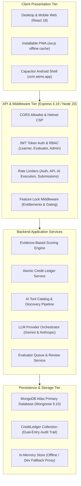

# AIIMS — Complete Repository Implementation Audit

**Audit Date:** November 2, 2026
**Auditor Role:** Senior Software Architect, Full-Stack Engineer, Application Security Engineer, QA Automation Engineer
**Codebase Baseline:** AIIMS v3.0 Monorepo (`main` branch)
**Document Status:** Complete Implementation & Technical Architecture Audit

---

## 1. Project Architecture & System Overview

The **AIIMS (AI Intelligence & Mentoring System)** platform is designed as an evidence-based AI capability diagnostic, tool discovery wallet, and prompt engineering mentoring platform. It supports multi-persona workflows across higher-education students, startup builders/entrepreneurs, academic evaluators, and system administrators.

---

## 2. Technology Stack & Dependencies

### 2.1 Frontend Stack (`Frontend/`)
- **Core Runtime:** React 18.3.1, TypeScript 5.4.5, Vite 5.2.11
- **Styling & Theming:** Custom CSS design tokens with light/dark theme CSS variables (`theme.ts`, `ThemeContext.tsx`)
- **3D & Canvas Visualization:** Three.js 0.169.0, `@react-three/fiber` 8.18.0, `@react-three/drei` 9.122.0
- **Icons:** `lucide-react` 0.378.0
- **Mobile Container:** `@capacitor/core` 6.2.2, `@capacitor/android` 6.2.2, `@capacitor/app` 6.0.3, `@capacitor/splash-screen` 6.0.4, `@capacitor/status-bar` 6.0.3
- **Linters & Tooling:** ESLint 10.13.0, TypeScript-ESLint 8.71.2, Prettier 3.9.10

### 2.2 Backend Stack (`Backend/`)
- **Core Runtime:** Node.js (>=20.0.0), Express 4.19.2, TypeScript 5.4.5
- **Database & ODM:** Mongoose 9.10.1 (targeting MongoDB Atlas with in-memory dev fallback)
- **Security & Cryptography:** `bcryptjs` 3.0.3, `jsonwebtoken` 9.0.2, `helmet` 8.3.0, `cors` 2.8.5, `csrf-csrf` 4.0.3, `otplib` 13.5.0, `lusca` 1.7.0
- **Validation:** Zod 4.6.7
- **AI Integrations:** `@google/generative-ai` 0.24.1, `@anthropic-ai/sdk` 0.20.0
- **Testing & Tooling:** Vitest 1.6.1, ts-node 10.9.2, Playwright 1.64.1

---

## 3. Frontend Architecture

### 3.1 Directory Structure & File Map
- `Frontend/src/main.tsx`: Application bootstrapping with React.StrictMode and providers.
- `Frontend/src/App.tsx`: Root application shell, routing manager (state-based active tab switching), hardware back-button listener, mobile drawer toggle, and global dialogs.
- `Frontend/src/context/`:
  - `LearnerContext.tsx`: Monolithic central client state container (~1,895 lines) storing user profile, credits, assessment, clarity, focus, radar, and wallet. Auto-syncs to `localStorage` and debounced `PUT /api/learner/state`.
  - `ThemeContext.tsx`: Theme mode provider (`light` / `dark`), manages `data-theme` attribute on `document.documentElement`.
- `Frontend/src/screens/`:
  - `home/HomeScreen.tsx` (~1,968 lines) & `PublicHeroScreen.tsx`: Unauthenticated and authenticated home views, 10-stage journey progress, and 3D hero.
  - `assessment/AssessmentScreen.tsx` (~2,601 lines): 15-question baseline AI capability diagnostic with radar visualization.
  - `analysis/AnalysisScreen.tsx` (~1,567 lines): My AI Profile analysis, spider/radar chart, capability strengths and growth areas.
  - `clarity/ClarityScreen.tsx` (~1,425 lines) & `Level2AITaskLab.tsx` (~1,549 lines): Interactive prompt engineering workspace and task sandbox.
  - `focus/FocusScreen.tsx` (~1,847 lines): Productivity and focus track timer with background sync and audio cues.
  - `wallet/AIWalletScreen.tsx` (~3,737 lines): Monolithic AI tool catalog, search, multi-domain filtering, tool comparison, and personal toolkit.
  - `radar/RadarScreen.tsx`: Emerging AI technological signals stream with filtering.
  - `investigation/InvestigationScreen.tsx`: Deep-dive technical signal investigation workspace.
  - `relevance/RelevanceScreen.tsx`: Domain relevance generator.
  - `solver/ProblemSolverScreen.tsx`: Workflow solver workspace.
  - `build/BuildScreen.tsx`: Project builder workspace.
  - `credits/CreditsScreen.tsx` (~1,653 lines): Spend/earn transaction ledger, plan upgrade tiers, and credit top-up UI.
  - `staff/`: `StaffLoginScreen.tsx`, `EvaluatorQueueScreen.tsx`, `EvaluationReviewScreen.tsx`, `AdminDashboardScreen.tsx`.
- `Frontend/src/components/`:
  - `3d/`: `Hero3DScene.tsx`, `Hero3DVisual.tsx`, `Assessment3DScene.tsx`, `OrbitalRings.tsx`, `WebGLBoundary.tsx`, `Hero2DFallback.tsx`.
  - `universe/LearningUniverseMap.tsx`: 7-destination interactive SVG universe map.
  - `common/`: `Header.tsx` (~1,329 lines), `Sidebar.tsx` (~908 lines), `BottomNav.tsx`, `LockedInterfaceScreen.tsx`.
- `Frontend/src/services/`:
  - `featureAccessService.ts`: Rule-based entitlement engine defining access conditions for all 10 journey stages and 4 levels.
  - `assessmentScoring.ts`: Client-side implementation of the 5-capability evidence scoring engine.
  - `recommendationEngine.ts`: Algorithm matching tools based on user profile and gaps.
  - `journeyResolver.ts`: Derives active stage and recommended next actions.

---

## 4. Backend Architecture

### 4.1 Request Processing Pipeline
1. **Security Headers & Middleware:** `helmet()`, `cors(corsOptions)`, `cookieParser()`, `express.json({ limit: '1mb' })`, `lusca.xframe('SAMEORIGIN')`.
2. **Rate Limiting:**
   - Auth Rate Limiter: 15 requests per 15 minutes (`/api/auth/*`).
   - General API Limiter: 120 requests per minute (`/api/*`).
   - AI Execution Limiter: 20 requests per minute (`/api/clarity/run-task`, `/api/ai/*`).
   - Submission Limiter: 30 requests per minute (`/api/submissions/*`).
   - Evaluator Limiter: 60 requests per minute (`/api/evaluator/*`).
   - Admin Limiter: 60 requests per minute (`/api/admin/*`).
3. **Authentication & Identity Middleware (`auth.middleware.ts`):**
   - Verifies Bearer JWT tokens.
   - In production: enforces strong JWT secrets (>=32 characters, rejects placeholders).
   - In development: falls back to ephemeral key if unset.
   - Populates `req.user` by querying MongoDB Atlas `User.findById()`, falling back to `registeredUsers` proxy store.
4. **Role Authorization Middleware:**
   - `requireRole('learner', 'evaluator', 'admin')`: Restricts administrative and evaluator endpoints.
5. **Feature Gating Middleware (`featureLock.middleware.ts`):**
   - `requireClarityUnlocked`: Enforces completion of assessment diagnostic before allowing Clarity mutations.
   - `requireInvestigationUnlocked`, `requireRelevanceUnlocked`, `requireMentorUnlocked`.

---

## 5. Database Architecture & Models

Mongoose models defined in `Backend/src/models/`:

| Model | Collection | Primary Responsibility | Indexing Status |
| :--- | :--- | :--- | :--- |
| `User` | `users` | Core user identity, credentials, role, learner state (assessment, clarity, focus, radar, investigation, wallet, transactions). | Indexed on `email` (unique), `role`, `stage`. |
| `CreditLedger` | `credit_ledgers` | Append-only financial credit audit log. Enforces unique compound index on `(userId, idempotencyKey)` to guarantee idempotency. | Indexed on `userId`, `idempotencyKey` (unique), `timestamp`. |
| `Submission` | `submissions` | Student prompt and task submissions for human evaluator grading. | Compound index on `status + submittedAt`, index on `learner`. |
| `AuditLog` | `audit_logs` | Immutable security and administrative event ledger. | Compound index on `action + timestamp`. |
| `Task` | `tasks` | Practice and assessment task catalog definitions. | Indexed on `taskId` (unique), `category`. |
| `AITool` | `ai_tools` | Curated AI tools, multi-domain mappings, and pricing models. | Indexed on `id` (unique), `category`, `domains`. |
| `ToolDiscoveryRun`| `tool_discovery_runs` | Telemetry for automated discovery scraping jobs. | Indexed on `startedAt`. |
| `ToolEvidence` | `tool_evidence` | Scraped evidence and release logs for tools. | Indexed on `toolId`. |
| `ToolVersionHistory`| `tool_version_histories` | Version and feature diff history for tools. | Indexed on `toolId + version`. |
| `StudentProfile` | `student_profiles` | Institutional profile mapping student to cohort and institute. | Indexed on `userId` (unique), `cohortId`. |
| `Cohort` | `cohorts` | Academic cohorts within educational institutions. | Indexed on `instituteId`. |
| `Institute` | `institutes` | Verified university and college partners. | Indexed on `domain` (unique). |

---

## 6. API Architecture & Route Inventory

| Route Path | Method | Auth Required | Middleware Guards | Controller Function | Description |
| :--- | :--- | :--- | :--- | :--- | :--- |
| `/health` | `GET` | No | None | Inline | Public service liveness probe. |
| `/ready` | `GET` | No | None | Inline | Readiness probe verifying DB connection. |
| `/api/csrf-token` | `GET` | No | RateLimited | Inline | Issues CSRF token cookie. |
| `/api/auth/register` | `POST` | No | RateLimited, Zod | `register` | Creates new user account. |
| `/api/auth/login` | `POST` | No | RateLimited, Zod | `login` | Validates credentials; handles 2FA. |
| `/api/auth/verify-totp` | `POST` | No | RateLimited, Zod | `verifyTotp` | Verifies TOTP 6-digit MFA code. |
| `/api/learner/state` | `GET` | **Yes** | `requireAuth` | `getLearnerState` | Retrieves authenticated learner state. |
| `/api/learner/state` | `PUT` | **Yes** | `requireAuth` | `updateLearnerState` | Syncs full learner state tree to DB. |
| `/api/credits/wallet` | `GET` | **Yes** | `requireAuth` | `getWallet` | Authoritative credit balance & summary. |
| `/api/credits/ledger` | `GET` | **Yes** | `requireAuth`, Zod | `getLedger` | Paginated CreditLedger transactions. |
| `/api/credits/balance` | `GET` | **Yes** | `requireAuth` | `getBalance` | Fast authoritative credit balance. |
| `/api/credits/award-level` | `POST` | **Yes** | `requireAuth`, Zod | `awardLevel` | Grants quest completion credit rewards. |
| `/api/credits/invest` | `POST` | **Yes** | `requireAuth`, Zod | `investCredits` | Atomically spends credits for features. |
| `/api/assessments/questions` | `GET` | No | RateLimited | `getQuestions` | 15-question baseline assessment. |
| `/api/assessments/submit` | `POST` | **Yes** | `requireAuth`, Zod | `submitAssessment` | Grades diagnostic & awards 50 AC. |
| `/api/analysis/peer-benchmarks`| `GET` | No | RateLimited | `getPeerBenchmarks` | Anonymous cohort benchmark stats. |
| `/api/analysis/individual` | `GET` | **No** *(Vulnerability)* | None | `getIndividualAnalysis` | Returns individual analysis (or mock). |
| `/api/clarity/gaps` | `GET` | No | RateLimited | `getGaps` | Returns capability gap list. |
| `/api/clarity/run-task` | `POST` | **Yes** | `requireAuth`, `requireClarityUnlocked` | `runTask` | Executes LLM task; meters 10 AC. |
| `/api/clarity/save-task-score` | `POST` | **Yes** | `requireAuth`, `requireClarityUnlocked` | `saveTaskScore` | Persists task rubric score & feedback. |
| `/api/wallet/catalog` | `GET` | No | RateLimited | `getCatalog` | Returns verified tool catalog. |
| `/api/wallet/user` | `GET` | **No** *(Vulnerability)* | None | `getUserWallet` | Returns user wallet tools. |
| `/api/wallet/add` | `POST` | **No** *(Vulnerability)* | None | `addToWallet` | Adds tool to wallet (mutates mock). |
| `/api/wallet/update-familiarity`| `POST`| **No** *(Vulnerability)* | None | `updateFamiliarity` | Updates tool status (mutates mock). |
| `/api/focus/override` | `POST` | **No** *(Vulnerability)* | None | `overrideFocus` | Mutates global mock focus area. |
| `/api/radar/follow` | `POST` | **No** *(Vulnerability)* | None | `toggleFollowSignal` | Mutates global mock radar signal. |
| `/api/submissions` | `POST` | **Yes** | `requireAuth`, `requireRole` | `submitTask` | Creates task submission for grading. |
| `/api/evaluator/queue` | `GET` | **Yes** | `requireAuth`, `requireRole('evaluator','admin')` | `getEvaluationQueue` | Fetches pending submission queue. |
| `/api/evaluator/submissions/:id/review` | `POST` | **Yes** | `requireAuth`, `requireRole` | `submitReview` | Submits evaluation rubric scores. |
| `/api/admin/evaluators` | `POST` | **Yes** | `requireAuth`, `requireRole('admin')` | `createEvaluator` | Invites/provisions evaluator. |

---

## 7. AI Integration Architecture

AIIMS connects to two LLM providers:
1. **Google Gemini (`@google/generative-ai`):**
   - Configured via `GEMINI_API_KEY` and `GEMINI_MODEL`.
   - Used for fast conversational prompting, Clarity task execution, and reflection suggestions.
   - Candidate model fallback loop in `claude.service.ts`: `['gemini-1.5-flash', 'gemini-1.5-pro', 'gemini-2.0-flash-exp']`.
2. **Anthropic Claude (`@anthropic-ai/sdk`):**
   - Configured via `ANTHROPIC_API_KEY` and `AI_TOOL_ASSESSMENT_MODEL`.
   - Used for open-ended assessment response grading against rubrics (`evaluateOpenEndedAnswer`) and multi-agent workflow evaluations.
   - Operates with strict deterministic fallbacks: if API keys are absent or invalid, it returns `status: 'unavailable'` without fabricating fake test scores (e.g., 85/80).

---

## 8. Android & Capacitor Mobile Architecture

### 8.1 Capacitor Native Wrapper
- **Config File:** `Frontend/capacitor.config.ts`
- **Application ID:** `com.aiims.app`
- **App Name:** `AIIMS`
- **Web Directory:** `dist`
- **Security Invariant:** `server.cleartext: false` (strictly disallows unencrypted HTTP in production), `server.androidScheme: 'https'`.
- **Plugins:** `@capacitor/app` (back-button interception), `@capacitor/splash-screen`, `@capacitor/status-bar`.

### 8.2 Android Shell Project (`Frontend/android/`)
- Native Gradle project with `app/build.gradle`.
- Dynamic version code and version name from environment (`VERSION_CODE`, `VERSION_NAME`).
- `AndroidManifest.xml`:
  - `android:allowBackup="false"` to prevent ADB data extraction.
  - Minimal permissions: only `android.permission.INTERNET` requested.
  - Adaptive mipmap icons (`mipmap-anydpi-v26/ic_launcher.xml`).
- Hardware back-button handler implemented in `Frontend/src/App.tsx:L123-L165`:
  - Closes active navigation drawer if open.
  - Closes active modals/dialogs if open.
  - Pops internal navigation history stack if present.
  - Calls `CapApp.exitApp()` only when on root `home` screen.

