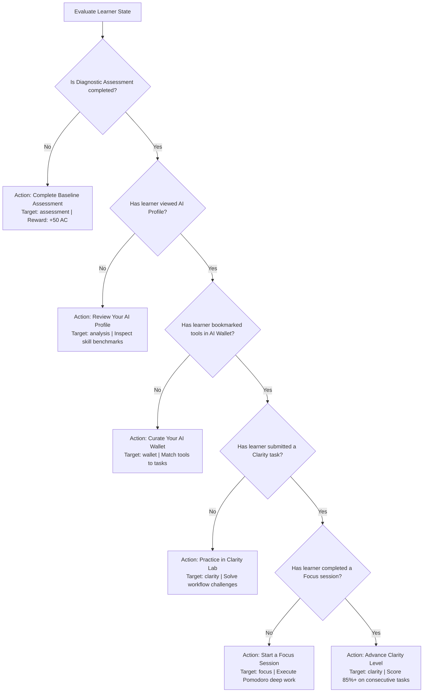

# AIIMS Learner Progress Calculations & Milestone Engine

## 1. Executive Summary

This specification outlines the mathematical rules, deterministic state transitions, and server-authoritative calculations governing learner progress across AIIMS.

The platform rejects arbitrary percentage increments, fabricated counters, and unverified achievements. All metrics are computed dynamically on the server from validated database entities (`User`, `QuestionAttempt`, `QuestionAssignment`, `LearnerClarityProgression`, `FocusSession`).

---

## 2. Canonical 10-Stage Milestone Definitions & Criteria

The AIIMS learning journey follows 10 canonical milestones spanning foundational literacy to autonomous system architecture:

```
[1. Understand AI]  -->  [2. My AI Profile]  -->  [3. AI Wallet]  -->  [4. Clarity Lab]  -->  [5. Focus Track]
        |                        |                     |                     |                     |
     Baseline                 Strengths &            Active               Workflow             Deep Work
    Diagnostic                Growth Areas           Toolkit              Rubrics               Pomodoro
        |                        |                     |                     |                     |
        v                        v                     v                     v                     v
[6. AI Radar]       -->  [7. AI Relevance]  -->  [8. Problem Solver] --> [9. Projects]  --> [10. AI Mentor]
     Emerging                 Personal             Multi-Agent          Scaffolded            Continuous
     Signals                   Impact             Architectures         Codebases             Coaching
```

### Deterministic Milestone Completion Rules

| Milestone # | Identifier | Name | Authoritative Completion Rule | Unlocking Prerequisite |
|---|---|---|---|---|
| **1** | `understand` | Understand AI | `User.assessment.status === 'completed'` | None (Available immediately to all registered learners). |
| **2** | `profile` | My AI Profile | `User.analysis.status === 'viewed'` | Milestone 1 completed (`assessment.status === 'completed'`). |
| **3** | `wallet` | AI Wallet | `User.wallet.length > 0` OR `aiWallet.userTools.length > 0` | Milestone 2 unlocked. |
| **4** | `clarity` | Clarity Lab | `User.clarity.completedTopics.length > 0` OR `QuestionAttempt.count(learnerId) > 0` | Milestone 3 unlocked. |
| **5** | `focus` | Focus Track | `User.focus.status === 'active'` OR `FocusSession.completed(learnerId) > 0` OR `focus.selectedTrack !== null` | Milestone 4 unlocked. |
| **6** | `radar` | AI Radar | `User.radar.investigatedSignalIds.length > 0` | Milestone 5 unlocked. |
| **7** | `relevance` | AI Relevance | `User.relevance.status === 'completed'` | Milestone 6 completed. |
| **8** | `solver` | Problem Solver | `User.solver.history.length > 0` | Milestone 7 completed. |
| **9** | `build` | Projects Workspace | `User.build.projects.length > 0` | Milestone 8 completed. |
| **10** | `mentor` | AI Mentor | Continuous milestone; status is `current` or `available` if Milestone 1 is completed. | Milestone 1 completed. |

---

## 3. Overall Progress Percentage Calculation

The overall progress percentage ($P_{\text{overall}}$) is a discrete, milestone-based calculation directly reflecting completed curriculum achievements:

$$P_{\text{overall}} = \text{round}\left(\frac{\sum_{i=1}^{10} \mathbb{I}(M_i = \text{'completed'})}{10} \times 100\right)$$

Where:
- $\mathbb{I}(\text{condition})$ is the indicator function returning $1$ if true, $0$ if false.
- $M_i$ is the status of Milestone $i$.
- For a learner who has completed the baseline diagnostic ($M_1$) and viewed their profile ($M_2$), $P_{\text{overall}} = \frac{2}{10} \times 100 = 20\%$.
- For a fresh registered learner who has not completed any milestones, $P_{\text{overall}} = 0\%$.

---

## 4. Current Stage Resolution Logic

The learner's primary active stage ($S_{\text{current}}$) is evaluated in canonical sequence from Milestone 1 to 10:

1. **If Milestone 1 is not completed:** Current stage is strictly **"Understand AI"**.
2. **Else if Milestone 2 is not completed:** Current stage is **"My AI Profile"**.
3. **Else if Milestone 3 is not completed:** Current stage is **"AI Wallet"**.
4. **Else if Milestone 4 is not completed:** Current stage is **"Clarity Lab"**.
5. **Else if Milestone 5 is not completed:** Current stage is **"Focus Track"**.
6. **Else if Milestone 6 is not completed:** Current stage is **"AI Radar"**.
7. **Else if Milestone 7 is not completed:** Current stage is **"AI Relevance"**.
8. **Else if Milestone 8 is not completed:** Current stage is **"Problem Solver"**.
9. **Else if Milestone 9 is not completed:** Current stage is **"Projects Workspace"**.
10. **Else if all 10 milestones are complete:** Current stage transitions to **"Continuous Mastery"**.

---

## 5. Authoritative Next Best Learning Action Decision Tree

The server provides a single, unambiguous recommendation for the learner's next step:



### Safety Rules:
- Recommendations **never** point to locked stages.
- The action button label and target tab allow one-click navigation directly to the recommended activity.

---

## 6. Focus Timekeeping & Break Accounting

Focus time calculations enforce mathematical boundaries to maintain data integrity:

### 6.1 Daily Focus Duration Formula
$$T_{\text{focus}} = \sum_{s \in S_{\text{completed}}} s.\text{accumulatedFocusSeconds}$$

Where $S_{\text{completed}}$ is the set of all sessions where:
- `learnerId === currentLearner`
- `status === 'completed'`
- `completedAt >= startOfToday`

### 6.2 Break Time Formula
$$T_{\text{break}} = \sum_{s \in S_{\text{completed}}} s.\text{totalBreakSeconds}$$

### 6.3 Separation Invariant
$$T_{\text{focus}} \cap T_{\text{break}} = \emptyset$$
Break seconds are tracked exclusively in `totalBreakSeconds` and are never added to `accumulatedFocusSeconds`.

### 6.4 Abandonment Threshold Rule
- A session terminated prematurely with $\text{accumulatedFocusSeconds} < 30$ seconds is discarded as accidental noise.
- A session terminated prematurely with $\text{accumulatedFocusSeconds} \ge 30$ seconds is preserved in audit logs with `status: 'abandoned'`, but is excluded from $S_{\text{completed}}$ and does not contribute to completed session tallies.

---

## 7. Clarity Difficulty Tier Advancement Calculations

Difficulty progression in Clarity Labs operates on a deterministic threshold model:

1. **Upward Advancement:**
   - A learner advances from `Easy` to `Medium`, or `Medium` to `Hard`, when:
     $$\text{consecutiveHighScores} \ge N_{\text{required}} \quad (\text{Default: } 2)$$
   - A high score is defined as:
     $$\text{score} \ge T_{\text{upward}} \quad (\text{Default: } 80\%)$$
   - Upon advancement, the consecutive high-score streak resets to $0$.

2. **Downward Calibration:**
   - A learner drops from `Hard` to `Medium`, or `Medium` to `Easy`, when:
     $$\text{score} < T_{\text{downward}} \quad (\text{Default: } 50\%)$$
   - A score of exactly $50\%$ maintains the current level (boundary condition).
   - A learner at `Easy` level cannot drop below `Easy`.

3. **Neutral Performance:**
   - A score between $50\%$ and $79\%$ maintains the current level but resets $\text{consecutiveHighScores}$ to $0$.

