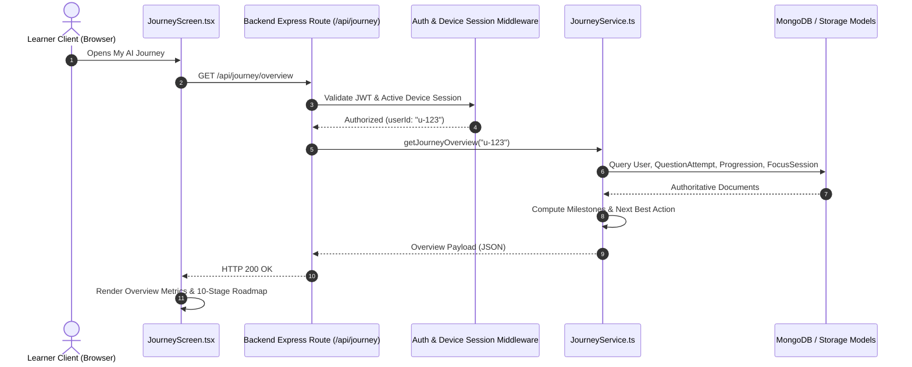

# AIIMS My AI Journey Architecture

## 1. Executive Summary & Design Principles

The **AIIMS My AI Journey & Assessment History Module** provides every learner with a server-authoritative, verifiable, and unified visualization of their learning trajectory, completed diagnostic evaluations, practice history in Clarity Labs, deep work focus activity, and personalized skill development.

### Core Architectural Tenets:
1. **Server-Authoritative Truth:** The journey screen never calculates progression percentages or milestone completion states independently on the client. All milestones, stage titles, and recommended next actions are derived directly from persisted records in MongoDB via `JourneyService`.
2. **Zero Hallucinated Progress:** Fresh learners with zero assessments receive an uninflated, clear 0% baseline progress view pointing to their diagnostic assessment, eliminating deceptive "fake-complete" indicators.
3. **Immutable Separate Attempt History:** Every submission (whether a diagnostic assessment, an iterative Clarity task attempt, or an applied lab evaluation) is preserved as an immutable individual historical record with its timestamp, score, and rubric feedback. Earlier attempts are never overwritten.
4. **Cross-Module Activity Integration:** Deeply integrates Prompt 4 (Question Bank), Prompt 5 (Clarity Labs), Prompt 6 (Focus Sessions), and Prompt 7 (AI Wallet) without duplicating data models or business logic.
5. **Strict Session & Ownership Isolation:** Every endpoint strictly validates the active device-bound session token (`requireAuth`) and scopes queries exclusively to `req.user.id`, preventing cross-learner history disclosure.

---

## 2. Component Structure & Frontend Architecture

The journey interface is located at `Frontend/src/screens/journey/JourneyScreen.tsx` and provides a responsive, accessible, token-compliant sub-tabbed architecture:

```
JourneyScreen (Container & Sub-Tab Navigator)
 ├── Header & Real-Time Sync Action (Sync Progress Button)
 ├── Sub-Navigation Bar:
 │    ├── Tab 1: Journey Overview
 │    │    ├── High-Level Metric Tiles (Progress %, Current Stage, Latest Diagnostic, Focus Duration)
 │    │    ├── Hero Card: Recommended Next Learning Action (Authoritative CTA)
 │    │    └── Central Milestone Roadmap (10 Canonical Stages with Expandable History)
 │    │
 │    ├── Tab 2: Assessment History
 │    │    ├── Filter Controls (By Type: All, Diagnostic, Clarity, Submission; By Status)
 │    │    ├── Paginated Attempt Table (Title, Type, Score, Status, Date)
 │    │    ├── Clean Empty State (Call to Action for New Learners)
 │    │    └── Record Detail Modal (Rubric Criteria Breakdown & Evaluator Comments)
 │    │
 │    ├── Tab 3: Clarity Progress
 │    │    ├── Current Difficulty Level Banner (Easy, Medium, Hard)
 │    │    ├── Formative vs. Submitted Disclosure Banner
 │    │    └── Topic-Wise Mastery Cards (Attempts, Last Score, Consecutive 85%+ Progress)
 │    │
 │    ├── Tab 4: Focus Activity
 │    │    ├── Today's Focus Minutes & Completed Sessions
 │    │    ├── Break Time Tracking (Strictly Excluded from Focus Totals)
 │    │    └── Historical Focus Session Log (Track, Intention, Actual Duration)
 │    │
 │    └── Tab 5: Skill Analytics
 │         ├── Data-Sufficiency Guard (Graceful notice when data is insufficient)
 │         ├── Demonstrated Core Strengths (Scores >= 70%)
 │         ├── Target Growth Opportunities (Scores < 70%)
 │         └── Chronological Evaluation Timeline (Non-aggregated real score progression)
```

---

## 3. End-to-End Data Flow



---

## 4. Sub-Module Integrations

### 4.1 Clarity Lab Integration
- **Source Model:** `QuestionAttempt` (for evaluated submissions) and `LearnerClarityProgression` (for level mastery).
- **Formative vs Submitted Separation:** The UI clearly articulates that clicking "Run" in the Clarity Task Lab executes an exploratory trial that is not recorded in permanent progression, whereas clicking "Submit" finalizes the attempt, deducts credits, and updates consecutive high-score counters.
- **Difficulty Tracking:** Reflects real-time difficulty tiers (`Easy`, `Medium`, `Hard`) per topic based on whether two consecutive scores $\ge 85\%$ have been achieved.

### 4.2 Focus Module Integration
- **Source Model:** `FocusSession` and `FocusSessionService`.
- **Break Exclusion:** Break intervals are tracked exclusively in `totalBreakSeconds` and are mathematically excluded from focus duration totals.
- **Abandoned Session Guard:** Sessions abandoned prior to completion are logged in audit history but excluded from completed session counters.

### 4.3 Diagnostic Assessment Integration
- **Source Model:** `User.assessment` and `User.analysis`.
- Displays the 5 foundational AI capability dimensions (Understanding, Using, Solving, Scaling, Adapting) normalized to $0-100\%$, with verified peer benchmarks and personal growth recommendations.

---

## 5. Security & Ownership Controls

1. **Authentication Enforcement:** All `/api/journey/*` routes require `requireAuth` middleware, which verifies active token validity and checks against the session store.
2. **Device-Bound Session Validation:** Requests with mismatched device hashes or revoked sessions are rejected with HTTP 401.
3. **No Client-Supplied Parameters:** The learner's ID is derived solely from the cryptographically verified JWT token (`req.user.id`). Any client-supplied user ID in request bodies or query strings is ignored.
4. **Information Leakage Prevention:** Assessment history endpoints omit system prompt templates, private rubric evaluator instructions, and internal question bank hashes.

