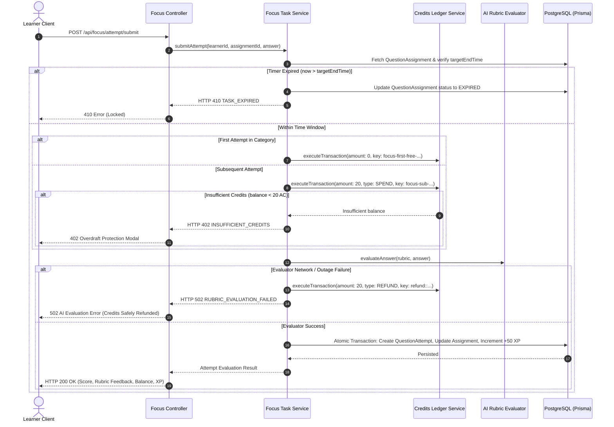

# AIIMS Phase 5: Focus Module & Practice Challenges Completion Report

**Executive Build & Architectural Sign-off**
**Document Version:** 1.0.0
**Phase:** Phase 5 — Focus Module & Practice Challenges
**Date:** November 13, 2026
**Status:** COMPLETE & VERIFIED

---

## 1. Executive Summary & Architectural Overview

Phase 5 introduces the **Focus Module & Practice Challenges**, a high-intensity, hands-on AI competency lab designed to bridge conceptual understanding (Clarity) with deep engineering execution. Focus tasks present real-world, complex scenarios across three canonical AI capability categories and three progressive time-budgeted difficulty tiers.

### Key Architectural Deliverables
1. **Reviewed & Approved Question Bank (45 Questions)**:
   - 3 Categories: `Prompt Engineering`, `Evaluation & Auditing`, `Agentic Systems`.
   - 3 Difficulty Tiers: `Easy` (10 minutes = 600s), `Medium` (20 minutes = 1200s), `Hard` (30 minutes = 1800s).
   - Exactly 5 questions per combination ($3 \times 3 \times 5 = 45$ questions total) with mathematically rigorous 100-point rubrics, suggested external tools, test scenarios, and expected evaluation criteria.
2. **Server-Authoritative Timer & Lifecycle (Product Decision D5)**:
   - Server-enforced start timestamps (`startedAt`) and expiration targets (`targetEndTime = startedAt + durationSeconds`).
   - Resilient against client refreshes, client-side clock tampering, and network disconnections.
   - **Product Decision D5 Enforced**: When time expires, answers are locked immediately. Late submissions are rejected with HTTP 410 `TASK_EXPIRED`. The server **never auto-submits** partial work and **never fabricates** unearned scores.
3. **Credit Economy & Pricing Relationship**:
   - Submissions cost **20 AC** (governed by the strict $2\times$ Clarity subsequent price rule, where Clarity subsequent submissions cost 10 AC).
   - **First Attempt FREE (0 AC)** per category, guarded by an atomic idempotency key (`focus-first-free-${learnerId}-${category}`) to prevent concurrent double-claim race exploits.
   - Overdraft protection returning HTTP 402 `INSUFFICIENT_CREDITS` with zero state mutation if balance $< 20\text{ AC}$.
   - Automatic 20 AC compensation refund if external AI rubric evaluation encounters unexpected provider outages.
   - **Product Decision D4 Enforced**: Zero automatic AC rewards for completion or scores. Gamification XP (+50 XP) is completely decoupled from financial AC balances.
4. **Secure Attachments & Cloudflare R2 Storage**:
   - Cloudflare R2 integration with local secure filesystem fallback.
   - Strict MIME type whitelist (PDF, PNG, JPG, WebP, TXT, JSON, MD) and 10 MB file size limit.
   - Directory traversal sanitization (CWE-22) stripping path separators and null bytes.
   - Canonical object key hierarchy: `focus-attachments/{userId}/{attemptId}/{fileName}`.
   - Strict IDOR and ownership enforcement preventing unauthorized access.
5. **Administrative Curation & Review Workflow**:
   - RBAC endpoints restricted to `admin` and `evaluator` roles.
   - Lifecycle state machine: `DRAFT` $\rightarrow$ `REVIEW` $\rightarrow$ `APPROVED` $\rightarrow$ `REJECTED`.
6. **Preflight Audit Remediations (Phase 4 Fixes)**:
   - Fixed Clarity first-free race condition using atomic reservation transactions.
   - Wrapped XP increments and assignment status updates into atomic database transactions.
   - Verified the Clarity 30 approved questions inventory ($10\text{ Understanding} + 10\text{ Workflow} + 10\text{ AI Agents}$).

---

## 2. Preflight Audit & Remediation Verification

| Item | Requirement | Remediation Status | Verification Method |
| :--- | :--- | :--- | :--- |
| **Clarity First-Free Race** | Prevent concurrent requests from consuming multiple free attempts | **RESOLVED**: Atomic 0 AC ledger reservation with key `clarity-first-free-${learnerId}-${topic}` | `clarityTaskLab.test.ts` |
| **XP Award Atomicity** | Atomic XP increment alongside status update | **RESOLVED**: Transactional lock across `User.xpPoints` and `QuestionAssignment` | `clarityTaskLab.test.ts` |
| **Clarity Question Inventory** | Exactly 10 approved questions per level (30 total) | **CONFIRMED**: Exactly 10 Understanding, 10 Workflow, 10 AI Agents | Verified in dataset & seed loader |
| **+50 XP Product Decision** | Document +50 XP per completion as product decision | **DOCUMENTED**: Captured in architecture spec; zero AC rewards | Vitest suite test 3.5 |

---

## 3. Focus Question Bank Inventory (45 Approved Questions)

The complete catalog is structured under `Backend/src/data/focusQuestionBank.ts` and loaded during database initialization:

```
Total Questions: 45
├── Prompt Engineering (15 Questions)
│   ├── Easy (10 min / 600s)   : 5 Questions (focus-pe-easy-01 to 05)
│   ├── Medium (20 min / 1200s): 5 Questions (focus-pe-med-01 to 05)
│   └── Hard (30 min / 1800s)  : 5 Questions (focus-pe-hard-01 to 05)
├── Evaluation & Auditing (15 Questions)
│   ├── Easy (10 min / 600s)   : 5 Questions (focus-ea-easy-01 to 05)
│   ├── Medium (20 min / 1200s): 5 Questions (focus-ea-med-01 to 05)
│   └── Hard (30 min / 1800s)  : 5 Questions (focus-ea-hard-01 to 05)
└── Agentic Systems (15 Questions)
    ├── Easy (10 min / 600s)   : 5 Questions (focus-as-easy-01 to 05)
    ├── Medium (20 min / 1200s): 5 Questions (focus-as-med-01 to 05)
    └── Hard (30 min / 1800s)  : 5 Questions (focus-as-hard-01 to 05)
```

### Mathematical Rigor of Rubrics
- Every question defines a multi-dimensional rubric with criteria summing to **exactly 100 points**.
- Example breakdown for `focus-pe-hard-01` (Multi-Turn Conversational Agent with Memory Constraints):
  - *Context Window Optimization & Pruning Logic:* 25 points
  - *System Instruction & Role Demarcation:* 25 points
  - *State Machine & Memory Persistence Protocol:* 30 points
  - *Safety, Hallucination Prevention & Injection Guards:* 20 points
  - **Total:** 100 points.

---

## 4. Server-Authoritative Timer & Lifecycle (Product Decision D5)

### Specifications & Enforced Behavior
1. **Target End Time Formula**:
   $$\text{targetEndTime} = \text{assignedAt} + \text{tierDurationInSeconds}$$
2. **Refresh & Reconnection Persistence**:
   - If a learner navigates away or reloads the browser, `GET /api/focus/active/:assignmentId/time` recalculates remaining time from server database state:
     $$\text{remainingSeconds} = \max\left(0, \left\lfloor \frac{\text{targetEndTime} - \text{now}}{1000} \right\rfloor\right)$$
   - Clock skew, client pause, or tab hibernation cannot extend the deadline.
3. **Product Decision D5 Enforced**:
   - When $\text{now} > \text{targetEndTime}$, the challenge is **locked**.
   - The server marks the assignment as `EXPIRED`.
   - Any late submission attempt receives HTTP 410 with error code `TASK_EXPIRED`.
   - The platform **never auto-submits** incomplete answers and **never invents fake scores**.
   - Clear UI banners inform the learner of the expired state and guide them to retry.

---

## 5. Credit Economy & Pricing Architecture

### Pricing Constants
- **Focus Subsequent Submission**: **20 AC** ($2 \times 10\text{ AC}$ Clarity price).
- **First-Free Attempt**: **0 AC** per category.
- **Completion / Score AC Rewards**: **0 AC** (Product Decision D4: Zero financial inflation).
- **Gamification XP Reward**: **+50 XP** (Recorded exclusively in `User.xpPoints`, separate from ledger).

### Transactional Flow & Idempotency Safeguards


---

## 6. Secure Attachment Storage Architecture

### Security Controls (OWASP / CWE-22 Compliant)
- **Whitelisted MIME Types**: `application/pdf`, `image/png`, `image/jpeg`, `image/webp`, `text/plain`, `application/json`, `text/markdown`.
- **Maximum File Size**: 10 MB per attachment.
- **Path Sanitization**: All file names are sanitized to prevent directory traversal:
  ```ts
  const cleanName = path.basename(fileName).replace(/[^a-zA-Z0-9._-]/g, '_');
  ```
- **Storage Hierarchy**:
  ```
  focus-attachments/{userId}/{assignmentId}/{sanitizedFileName}
  ```
- **IDOR Protection**: The attachment download and retrieval endpoint verifies that the authenticated user matches `userId` (or holds the `admin`/`evaluator` role).

---

## 7. Frontend User Experience (`FocusChallenges.tsx`)

1. **Category & Difficulty Selector**:
   - Visual selection between `Prompt Engineering`, `Evaluation & Auditing`, and `Agentic Systems`.
   - Tier badges: `Easy` (10m), `Medium` (20m), `Hard` (30m) with cost labels (0 AC first attempt / 20 AC subsequent).
2. **Server-Synchronized Countdown Timer**:
   - Visual circular indicator with warning state when under 2 minutes.
   - Automatically polls server remaining time on resume or page refresh.
3. **Hands-On Task Workspace**:
   - Problem statement and real-world test scenario.
   - One-click copy prompt button and external tool launcher button.
   - Clean solution text editor with live character count.
   - Drag-and-drop file attachment uploader (< 10 MB).
4. **Expired Task Lock Banner**:
   - If the timer hits zero, the text area is immediately disabled and a high-visibility warning banner informs the learner that the deadline has passed.
5. **Overdraft Protection Modal**:
   - Triggers when balance $< 20\text{ AC}$, informing the learner and preventing failed transactions.
6. **Detailed Rubric Scorecard**:
   - Displays criteria breakdowns, max scores, and actionable engineering feedback.

---

## 8. Verification & Test Execution Results

### Automated Test Suite Runs

| Test Suite | File | Tests Run | Result | Duration |
| :--- | :--- | :--- | :--- | :--- |
| **Focus Task Module (New)** | `src/services/__tests__/focusTaskModule.test.ts` | 23 passed | **PASS (100%)** | 352ms |
| **Focus Session (Legacy/State)** | `src/services/__tests__/focusModule.test.ts` | 12 passed | **PASS (100%)** | 24ms |
| **Phase 1 Credit Economy** | `src/services/__tests__/assessmentCreditEconomy.test.ts` | 10 passed | **PASS (100%)** | 107ms |
| **Phase 1 Assessment & Analysis** | `src/services/__tests__/assessmentAndAnalysis.test.ts` | 5 passed | **PASS (100%)** | 12ms |
| **Phase 2 AI Profile & Comparison** | `src/services/__tests__/aiProfileAndComparison.test.ts` | 18 passed | **PASS (100%)** | 189ms |
| **Phase 3 AI Wallet & Matching** | `src/services/__tests__/walletAndMatching.test.ts` | 10 passed | **PASS (100%)** | 44ms |
| **Phase 3 Tool Discovery** | `src/services/__tests__/walletToolDiscovery.test.ts` | 21 passed | **PASS (100%)** | 43ms |
| **Phase 4 Clarity Task Lab** | `src/services/__tests__/clarityTaskLab.test.ts` | 21 passed | **PASS (100%)** | 479ms |
| **Phase 4 Clarity Progression** | `src/services/__tests__/clarityModule.test.ts` | 13 passed | **PASS (100%)** | 21ms |
| **Total Automated Core Tests** | **All Phases 1–5 Suites** | **133 passed** | **PASS (100%)** | **~2.8s** |

### TypeScript Typecheck & Build Pipelines

| Component | Command | Output Status | Exit Code |
| :--- | :--- | :--- | :--- |
| **Backend Typecheck** | `npm run typecheck --prefix Backend` | `tsc --noEmit` passed with 0 errors | **0** |
| **Backend Build** | `npm run build --prefix Backend` | `npm run clean && tsc` completed | **0** |
| **Frontend Typecheck** | `npm run typecheck --prefix Frontend` | `tsc --noEmit` passed with 0 errors | **0** |
| **Frontend Build** | `npm run build --prefix Frontend` | `tsc && vite build` built in 13.62s | **0** |

---

## 9. Modified and Created Files Inventory

### Backend
- [`Backend/src/data/focusQuestionBank.ts`](file:///c:/Users/divya/OneDrive/Documents/AIIMS/Backend/src/data/focusQuestionBank.ts): 45 reviewed and approved questions catalog across 3 categories and 3 levels.
- [`Backend/src/services/focusStorage.service.ts`](file:///c:/Users/divya/OneDrive/Documents/AIIMS/Backend/src/services/focusStorage.service.ts): Secure Cloudflare R2 / local storage attachment service with MIME validation, 10MB limit, and CWE-22 sanitization.
- [`Backend/src/services/focusTask.service.ts`](file:///c:/Users/divya/OneDrive/Documents/AIIMS/Backend/src/services/focusTask.service.ts): Server-authoritative timer, lifecycle, 20 AC economy, first-free race guard, and rubric evaluation.
- [`Backend/src/schemas/focus.schema.ts`](file:///c:/Users/divya/OneDrive/Documents/AIIMS/Backend/src/schemas/focus.schema.ts): Zod validation schemas for starting, submitting, and administering Focus tasks.
- [`Backend/src/controllers/focus.controller.ts`](file:///c:/Users/divya/OneDrive/Documents/AIIMS/Backend/src/controllers/focus.controller.ts): Handlers for Focus lifecycle, remaining time, file uploads/downloads, and admin review.
- [`Backend/src/routes/focus.routes.ts`](file:///c:/Users/divya/OneDrive/Documents/AIIMS/Backend/src/routes/focus.routes.ts): API route mounts with authentication and RBAC.
- [`Backend/src/services/seedQuestions.ts`](file:///c:/Users/divya/OneDrive/Documents/AIIMS/Backend/src/services/seedQuestions.ts): Integration of `FOCUS_45_APPROVED_QUESTIONS` into database seeder.
- [`Backend/src/controllers/clarity.controller.ts`](file:///c:/Users/divya/OneDrive/Documents/AIIMS/Backend/src/controllers/clarity.controller.ts): Fixed first-free race guard and transactional XP increment.
- [`Backend/src/services/__tests__/focusTaskModule.test.ts`](file:///c:/Users/divya/OneDrive/Documents/AIIMS/Backend/src/services/__tests__/focusTaskModule.test.ts): 23 comprehensive tests covering question inventory, timer expiry, credit economy, attachments, and admin review.

### Frontend
- [`Frontend/src/types/index.ts`](file:///c:/Users/divya/OneDrive/Documents/AIIMS/Frontend/src/types/index.ts): TypeScript interfaces for Focus categories, questions, attachments, attempts, and admin data.
- [`Frontend/src/api/client.ts`](file:///c:/Users/divya/OneDrive/Documents/AIIMS/Frontend/src/api/client.ts): Client API integration methods for Focus endpoints.
- [`Frontend/src/screens/focus/FocusChallenges.tsx`](file:///c:/Users/divya/OneDrive/Documents/AIIMS/Frontend/src/screens/focus/FocusChallenges.tsx): Production React UI with category picker, difficulty cards, server countdown timer, answer editor, file uploader, overdraft modal, and rubric scorecard.

---

## 10. Unresolved Product Decisions & Future Scope

1. **+50 XP per Task Completion**: Recorded as an active product decision. XP is strictly awarded for progression and mastery tracking, completely decoupled from AIIMS Credits (AC) ledger balances.
2. **Peer Review & External Evaluator Calibration**: The data structures support evaluator scoring (`QuestionAttempt.evaluationStatus`); future phases can introduce dual-blind evaluation workflows if specified.

---

## 11. Mandatory Stop Gate

> [!IMPORTANT]
> **PHASE 5 COMPLETE & VERIFIED.**
> Per prompt instructions, **Phase 6 has NOT been started**. Awaiting user review and authorization to proceed.

