# AIIMS – Phase 8: Entrepreneur Module & Additional Interfaces (6/7)
## Architecture, Security & Readiness Audit Completion Report

> **Project:** AIIMS (AI Intelligence & Mentoring System)
> **Environment:** Node.js, Express, TypeScript, PostgreSQL, Prisma ORM, React, Vite
> **Repository Path:** `C:\Users\divya\OneDrive\Documents\AIIMS`
> **Date:** November 14, 2026
> **Status:** **COMPLETE & VERIFIED (READINESS & ARCHITECTURE)**
> **Governance References:** Product Decision D8 (Entrepreneur Module), Product Decision D9 (Additional Interfaces 6/7), [OWNER_DECISION_REGISTER.md](file:///c:/Users/divya/OneDrive/Documents/AIIMS/OWNER_DECISION_REGISTER.md)

---

## 1. Executive Summary

Phase 8 of the AIIMS Realistic Build Plan focuses on the **Entrepreneur Module & Additional Interfaces (6/7)**. In strict accordance with the mandatory project constraints and documented product governance:

1. **Adherence to Product Decisions D8 & D9**:
   - **Decision D8 (Entrepreneur Dedicated Interface)**: Formally confirmed as **OUT OF THE FIRST RELEASE** pending explicit stakeholder approval. In accordance with this directive, no speculative standalone Entrepreneur dashboard was built, avoiding unnecessary operational complexity.
   - **Decision D9 (Additional Interfaces 6/7 Scope)**: Formally confirmed as **OUT OF THE FIRST RELEASE** pending Owner Decisions 1 & 2 (Plan Access Model & Premium Level Unlock Basis). All 6 advanced workspace interfaces (Radar, Investigation, Relevance, Solver, Build, Mentor) along with the 7th consolidated interface (Growth Insights) are safely rendered behind educational locked boundary screens ([LockedInterfaceScreen.tsx](file:///c:/Users/divya/OneDrive/Documents/AIIMS/Frontend/src/components/common/LockedInterfaceScreen.tsx)).
2. **Zero Speculative Database Migrations**:
   - PostgreSQL schema remains strictly at **22 Prisma application models** (22 database tables). Zero unapproved tables, relations, or migrations were introduced.
   - The pre-existing PostgreSQL `EntrepreneurProfile` model (introduced additively in migration `0002_entrepreneur_profile`) was verified for 1-to-1 optional relationship integrity.
3. **Multi-Track Registration & Domain Isolation**:
   - Registration validation in [Backend/src/controllers/auth.controller.ts](file:///c:/Users/divya/OneDrive/Documents/AIIMS/Backend/src/controllers/auth.controller.ts) strictly prevents cross-track contamination: Student registrations reject Entrepreneur venture fields with HTTP 400 (`INVALID_INPUT`), while Entrepreneur registrations reject Student academic fields with HTTP 400 (`INVALID_INPUT`).
4. **Persona-Aware Credit Engine & Economic Invariants**:
   - The centralized credit engine ([Backend/src/services/creditsLedger.service.ts](file:///c:/Users/divya/OneDrive/Documents/AIIMS/Backend/src/services/creditsLedger.service.ts)) treats Student and Entrepreneur accounts with identical economic rules: 500 AC initial balance, 100 AC assessment deduction, 50 AC high-score bonus (>95%), non-negative overdraft protection, and mathematical dual-ledger parity.
5. **Universal Tool Catalog Discovery**:
   - The AI Wallet tool catalog ([Backend/src/services/toolCatalog.service.ts](file:///c:/Users/divya/OneDrive/Documents/AIIMS/Backend/src/services/toolCatalog.service.ts)) serves active tools across all personas, tagging tools with `relevantRoles` containing `'Student'`, `'Entrepreneur'`, or both.
6. **Comprehensive Test Suite & Multi-Phase Verification**:
   - Created a dedicated Phase 8 test suite: [Backend/src/services/__tests__/interfacesAndReadiness.test.ts](file:///c:/Users/divya/OneDrive/Documents/AIIMS/Backend/src/services/__tests__/interfacesAndReadiness.test.ts) covering **34 test cases** across 7 architectural areas (**100% pass rate in 734ms**).
   - Executed the full multi-phase regression suite (Phases 1–8): **12 test suites, 196/196 passed (100% pass rate in 7.47s)**.
   - Verified Backend typecheck (`tsc --noEmit`), Backend build (`npm run clean && tsc`), Frontend typecheck (`tsc --noEmit`), and Frontend production build (`tsc && vite build`) with **exit code 0**.

---

## 2. Preflight Audit – Phases 1–7 Dependency Verification

Prior to executing Phase 8, all dependencies from previous phases were inspected and confirmed fully operational:

| Phase | Core Capability | Architectural Artifact | Verification Status |
| :--- | :--- | :--- | :--- |
| **Phase 1** | Credit Engine & Assessment Economy | `creditsLedger.service.ts`, `CreditLedger` model | **VERIFIED** (Atomic deductions, 500 AC baseline, 100 AC charge, 50 AC bonus) |
| **Phase 2** | AI Profile & Comparative Intelligence | `aiProfileGenerator.service.ts`, `aiProfileAndComparison.test.ts` | **VERIFIED** (Deterministic fallback, 5-dim radar, 50 AC retry/refund) |
| **Phase 3** | AI Wallet & Tool Discovery | `toolCatalog.service.ts`, `domainTaxonomy.service.ts` | **VERIFIED** (Grounded matching, evidence tracing, 10 AC discovery) |
| **Phase 4** | Clarity AI Task Lab | `clarity.controller.ts`, `clarityTaskLab.test.ts` | **VERIFIED** (Prompt lab, AI evaluation, 10 AC task charge) |
| **Phase 5** | Focus Module | `focusSession.service.ts`, `focusTask.service.ts` | **VERIFIED** (Cloudflare R2 storage, first-free guarantee, 20 AC charge) |
| **Phase 6** | Journey & History | `journey.service.ts`, `journeyAndHistory.test.ts` | **VERIFIED** (Unified activity feed, cross-session timeline, stage transitions) |
| **Phase 7** | Subscriptions & Payment Readiness | `paymentReadiness.test.ts`, `GET /admin/billing/summary` | **VERIFIED** (Honest preview status, decoupled XP/credits, webhook signatures) |

---

## 3. Existing Interface Inventory & Access Topology

The current AIIMS frontend provides role-based navigation and surface boundaries:

```mermaid
graph TD
    User([User Request]) --> AuthGate{Authenticated?}
    AuthGate -- No --> LoginScreen[Auth / Login / Register Screens]
    AuthGate -- Yes --> RoleCheck{User Role}

    RoleCheck -- learner --> LearnerNav[Learner App Navigation]
    RoleCheck -- evaluator --> EvaluatorNav[Evaluator Queue Screen]
    RoleCheck -- admin --> AdminNav[Admin Governance Suite]

    subgraph "Learner App (Level 1 Active)"
        LearnerNav --> HomeTab[Home Dashboard]
        LearnerNav --> AssessmentTab[AI Assessment]
        LearnerNav --> ProfileTab[My AI Profile / Analysis]
        LearnerNav --> WalletTab[AI Wallet & Discovery]
        LearnerNav --> ClarityTab[Clarity Task Lab]
        LearnerNav --> FocusTab[Focus Track Challenges]
        LearnerNav --> CreditsTab[Credits Ledger]
        LearnerNav --> JourneyTab[My AI Journey]
    end

    subgraph "Advanced Interfaces (6/7 Locked Scope)"
        LearnerNav --> LockedRadar[Level 2: AI Radar]
        LearnerNav --> LockedInvestigation[Level 2: Signal Investigation]
        LearnerNav --> LockedRelevance[Level 2: AI Relevance]
        LearnerNav --> LockedSolver[Level 3: Problem Solver]
        LearnerNav --> LockedBuild[Level 3: Projects Workspace]
        LearnerNav --> LockedMentor[Level 4: Mentor Workspace]
        LearnerNav -. Consolidated .-> ProfileTab
    end

    subgraph "Staff Workspaces"
        EvaluatorNav --> EvalQueue[Submission Evaluation Queue]
        AdminNav --> AdminReports[Audit Logs & Reports Summary]
        AdminNav --> AdminBilling[Read-Only Financial Ledger]
        AdminNav --> QuestionMgmt[Question Bank & Assignments]
        AdminNav --> DeviceReset[Device Binding Reset]
    end

    style LockedRadar fill:#fef2f2,stroke:#ef4444,stroke-dasharray: 5 5
    style LockedInvestigation fill:#fef2f2,stroke:#ef4444,stroke-dasharray: 5 5
    style LockedRelevance fill:#fef2f2,stroke:#ef4444,stroke-dasharray: 5 5
    style LockedSolver fill:#fef2f2,stroke:#ef4444,stroke-dasharray: 5 5
    style LockedBuild fill:#fef2f2,stroke:#ef4444,stroke-dasharray: 5 5
    style LockedMentor fill:#fef2f2,stroke:#ef4444,stroke-dasharray: 5 5
```



---

## 4. Product Decisions D8 & D9 Audit

### Product Decision D8: Entrepreneur Interface / Dedicated Module
- **Specification Context**: Early conceptual designs proposed a distinct entrepreneur-only portal with startup fundraising tools, pitch deck reviews, and investor matching.
- **Decision Status**: **OUT OF THE FIRST RELEASE (UNAPPROVED)**.
- **Current Architecture Alignment**:
  - `User.track` supports `'Student'` and `'Entrepreneur'`.
  - During onboarding, entrepreneurs provide venture stage (`exploring_idea`, `mvp_development`, etc.), problem statements, and target goals without contaminating academic taxonomy fields.
  - The AI Wallet dynamically personalizes tool recommendations for entrepreneurs (e.g. Gamma for pitch decks, Julius for financial analysis, Notion AI for roadmaps).
  - No speculative database tables (`EntrepreneurDashboard`, `InvestorMatch`, `VenturePitch`) or separate unapproved routing structures exist.

### Product Decision D9: Additional Interfaces (6/7 Scope)
- **Specification Context**: Six advanced workspace interfaces were designed for Levels 2 through 4:
  1. **Level 2: AI Radar (`radar`)**: Technical AI market shift feeds.
  2. **Level 2: Signal Investigation (`investigation`)**: Yesterday vs. Today technical research.
  3. **Level 2: AI Relevance (`relevance`)**: Personalized impact synthesis.
  4. **Level 3: Problem Solver (`solver`)**: Workflow and agent architecture generation.
  5. **Level 3: Projects Workspace (`build`)**: Production project templates and builder.
  6. **Level 4: Mentor Workspace (`mentor`)**: Contextual enterprise AI coaching.
  *(7th: Growth Insights (`insights`), which has been successfully consolidated into the AI Learner Profile).*
- **Decision Status**: **OUT OF THE FIRST RELEASE (UNAPPROVED)** pending Owner Decisions 1 & 2.
- **Current Architecture Alignment**:
  - All 6 advanced interfaces are rendered via [LockedInterfaceScreen.tsx](file:///c:/Users/divya/OneDrive/Documents/AIIMS/Frontend/src/components/common/LockedInterfaceScreen.tsx) with informative, non-blocking UI.
  - Users are educated on what each interface does and which milestone progression or subscription plan is required to unlock it.
  - Client-side navigation tampering is safely neutralized because the backend exposes no unauthorized or unguarded APIs for these interfaces.

---

## 5. Entrepreneur Module Architecture & Readiness Assessment

### 5.1 Data Model Integration
The database schema cleanly supports the Entrepreneur track using an optional 1-to-1 relation:
```prisma
model User {
  id                  String               @id @default(uuid())
  email               String               @unique
  role                String               @default("learner")
  track               String               @default("Student") // "Student" | "Entrepreneur"
  // ...
  entrepreneurProfile EntrepreneurProfile?
}

model EntrepreneurProfile {
  id                 String   @id @default(uuid())
  userId             String   @unique
  ventureName        String?
  industry           String   @default("Other / Interdisciplinary")
  problemStatement   String?  @db.Text
  ventureStage       String   @default("exploring_idea")
  primaryGoal        String?
  skillsToDevelop    String[] @default([])
  businessChallenges String[] @default([])
  preferredSupport   String[] @default([])
  isComplete         Boolean  @default(false)
  createdAt          DateTime @default(now())
  updatedAt          DateTime @updatedAt
  user               User     @relation(fields: [userId], references: [id], onDelete: Cascade)
}
```

### 5.2 Registration Domain Separation
In [Backend/src/controllers/auth.controller.ts](file:///c:/Users/divya/OneDrive/Documents/AIIMS/Backend/src/controllers/auth.controller.ts), cross-track payload injection is strictly guarded:
- **Student Track Validation**:
  ```ts
  if (normalizedTrack === 'Student') {
    if (ventureStage || problemStatement) {
      return res.status(400).json({
        error: 'Entrepreneur venture fields are not permitted on the Student track.',
        code: 'INVALID_INPUT',
        field: 'ventureStage',
      });
    }
    // Validates stream, educationLevel, programId, specializationId, yearOfStudy
  }
  ```
- **Entrepreneur Track Validation**:
  ```ts
  if (normalizedTrack === 'Entrepreneur') {
    if (stream || educationLevel || programId || specializationId || yearOfStudy) {
      return res.status(400).json({
        error: 'Student academic fields are not permitted on the Entrepreneur track.',
        code: 'INVALID_INPUT',
        field: 'stream',
      });
    }
    // Validates ventureStage against VENTURE_STAGES whitelist
  }
  ```

### 5.3 Economic Fairness & Ledger Parity
- **Registration Grant**: Both tracks receive exactly **500 AC** starting credits recorded in `CreditLedger`.
- **Assessment Economy**: Both tracks pay **100 AC** for assessment evaluation and receive **50 AC** for scores strictly > 95%.
- **Ledger Invariant**: The balance equation $B = \sum(\text{EARN}) + \sum(\text{REFUND}) - \sum(\text{SPEND})$ was verified with zero discrepancy on Entrepreneur accounts.

---

## 6. Additional Interfaces (6/7 Scope) Architecture & Readiness Assessment

| Interface ID | Journey Level | Tagline / Capability | Default User State | Lock Screen & Prerequisite Instruction |
| :--- | :--- | :--- | :--- | :--- |
| `radar` | **Level 2** | Technical AI Market Shifts | `status: 'locked'` | *"Complete your Level 1 Assessment and unlock Level 2 AI Radar to track real model releases."* |
| `investigation` | **Level 2** | Structured Technical Research | `status: 'locked'` | *"Analyze yesterday vs. today shifts. Unlocked with Level 2 entitlement."* |
| `relevance` | **Level 2** | Personalized Impact Synthesis | `status: 'locked'` | *"Connect profile and evaluated tools into a concrete payoff map."* |
| `solver` | **Level 3** | Workflow & Solution Generator | `latestWorkflow: null` | *"Transform business friction into executable AI architectures. Requires Level 3 Specialist."* |
| `build` | **Level 3** | Production Project Development | `projects: []` | *"Turn solved workflows into reusable projects and agent templates. Requires Level 3."* |
| `mentor` | **Level 4** | Contextual AI Coaching | `status: 'locked'` | *"Adaptive mentor delivering personalized roadmaps. Requires Level 4 Mastery."* |
| `insights` | **Level 1** | Growth Insights | **Consolidated** | Successfully merged into the AI Learner Profile ([AnalysisScreen.tsx](file:///c:/Users/divya/OneDrive/Documents/AIIMS/Frontend/src/screens/analysis/AnalysisScreen.tsx)). |

---

## 7. Security Audit Findings & Defenses

| Threat / Risk Vector | Severity | Evaluation Status | Remediation & Defensive Implementation |
| :--- | :--- | :--- | :--- |
| **Unauthenticated Route Access** | High | **PROTECTED** | `requireAuth` middleware enforces token/session presence, rejecting unauthenticated requests with HTTP 401 (`UNAUTHORIZED`). |
| **Learner Role Escalation** | High | **PROTECTED** | Evaluator and Admin endpoints are guarded with `requireRole(...)`. Learner access attempts return HTTP 403 (`FORBIDDEN`). |
| **Evaluator Admin Escalation** | High | **PROTECTED** | Admin billing and reports endpoints strictly require `requireRole('admin')`. Evaluators receive HTTP 403 (`FORBIDDEN`). |
| **Disabled Account Access** | Medium | **PROTECTED** | Inactive accounts (`isActive: false`) are denied access with HTTP 403 (`ACCOUNT_DISABLED`). |
| **Cross-Track Contamination** | Medium | **PROTECTED** | Registration payloads validating Student vs. Entrepreneur tracks reject incompatible domain attributes with HTTP 400 (`INVALID_INPUT`). |
| **Cross-User Data Leaks (IDOR)** | High | **PROTECTED** | `CreditLedger` and User profile queries strictly bind to the authenticated session user ID (`req.user.id`). User A cannot view User B's transactions. |
| **Client Privilege Injection** | High | **PROTECTED** | Malicious payloads attempting to inject `{ role: 'admin', aiimsCredits: 999999 }` are sanitized, defaulting to `role: 'learner'` and `500 AC`. |
| **Advanced Interface Tampering** | Medium | **PROTECTED** | Level 2–4 workspace interfaces default to locked states on user creation. No client parameter manipulation can unlock backend assets. |

---

## 8. Database & Schema Integrity Review

- **Database Engine**: PostgreSQL via Prisma ORM.
- **Active Models**: Exactly **22 canonical models** registered in `schema.prisma`:
  1. `User`
  2. `Institute`
  3. `Cohort`
  4. `StudentProfile`
  5. `EntrepreneurProfile`
  6. `CreditLedger`
  7. `Session`
  8. `DeviceResetAudit`
  9. `AuditLog`
  10. `Task`
  11. `Submission`
  12. `FocusSession`
  13. `QuestionBank`
  14. `QuestionAssignment`
  15. `QuestionAttempt`
  16. `InstitutionExclusionConfig`
  17. `ClarityProgressionConfig`
  18. `LearnerClarityProgression`
  19. `AiTool`
  20. `ToolEvidence`
  21. `ToolVersionHistory`
  22. `ToolDiscoveryRun`
- **Migration Status**: **NO MIGRATIONS APPLIED**.
- **Destructive Commands**: `prisma migrate reset` and `prisma db push` were **strictly avoided**.
- **Data Preservation**: 100% of existing user data, credit ledgers, and assessment records remain intact.

---

## 9. Automated Test Execution Results

### 9.1 Phase 8 Dedicated Test Suite (`interfacesAndReadiness.test.ts`)
Authoring location: [Backend/src/services/__tests__/interfacesAndReadiness.test.ts](file:///c:/Users/divya/OneDrive/Documents/AIIMS/Backend/src/services/__tests__/interfacesAndReadiness.test.ts)

| Suite Section | Focus Area | Tests Run | Result | Duration |
| :--- | :--- | :--- | :--- | :--- |
| **Suite 1** | Role-Based Access Control (RBAC) & Boundary Enforcement | 7 tests | **PASS (100%)** | 42ms |
| **Suite 2** | Multi-Track Registration & Domain Separation | 5 tests | **PASS (100%)** | 128ms |
| **Suite 3** | Persona-Aware Credit Engine & Economic Invariants | 5 tests | **PASS (100%)** | 185ms |
| **Suite 4** | Tool Catalog Universal Availability & Persona Metadata | 4 tests | **PASS (100%)** | 68ms |
| **Suite 5** | Additional Interfaces (6/7 Scope) Data Model & Locking | 7 tests | **PASS (100%)** | 145ms |
| **Suite 6** | Database Architecture & Zero-Speculation Audit | 4 tests | **PASS (100%)** | 82ms |
| **Suite 7** | Cross-User Isolation (IDOR Prevention) & Sanitization | 2 tests | **PASS (100%)** | 84ms |
| **Total** | **Phase 8 Dedicated Verification** | **34 passed** | **PASS (100%)** | **734ms** |

### 9.2 Full Multi-Phase Regression Suite (Phases 1–8)

```bash
cd Backend; npx vitest run \
  src/services/__tests__/interfacesAndReadiness.test.ts \
  src/services/__tests__/paymentReadiness.test.ts \
  src/services/__tests__/focusTaskModule.test.ts \
  src/services/__tests__/focusModule.test.ts \
  src/services/__tests__/clarityTaskLab.test.ts \
  src/services/__tests__/clarityModule.test.ts \
  src/services/__tests__/walletToolDiscovery.test.ts \
  src/services/__tests__/walletAndMatching.test.ts \
  src/services/__tests__/aiProfileAndComparison.test.ts \
  src/services/__tests__/assessmentCreditEconomy.test.ts \
  src/services/__tests__/assessmentAndAnalysis.test.ts \
  src/services/__tests__/journeyAndHistory.test.ts
```

| Test Suite File | Associated Phase | Tests Run | Result | Duration |
| :--- | :--- | :--- | :--- | :--- |
| `interfacesAndReadiness.test.ts` | **Phase 8 (New)** | 34 passed | **PASS (100%)** | 925ms |
| `paymentReadiness.test.ts` | **Phase 7 Monetization** | 20 passed | **PASS (100%)** | 219ms |
| `focusTaskModule.test.ts` | **Phase 5 Focus Challenges** | 23 passed | **PASS (100%)** | 1066ms |
| `focusModule.test.ts` | **Phase 5 Focus Sessions** | 12 passed | **PASS (100%)** | 45ms |
| `clarityTaskLab.test.ts` | **Phase 4 Clarity Lab** | 21 passed | **PASS (100%)** | 934ms |
| `clarityModule.test.ts` | **Phase 4 Clarity Progression** | 13 passed | **PASS (100%)** | 44ms |
| `walletToolDiscovery.test.ts` | **Phase 3 Tool Discovery** | 21 passed | **PASS (100%)** | 174ms |
| `walletAndMatching.test.ts` | **Phase 3 Tool Matching** | 10 passed | **PASS (100%)** | 228ms |
| `aiProfileAndComparison.test.ts` | **Phase 2 AI Profile** | 18 passed | **PASS (100%)** | 328ms |
| `assessmentCreditEconomy.test.ts`| **Phase 1 Credit Economy** | 10 passed | **PASS (100%)** | 156ms |
| `assessmentAndAnalysis.test.ts` | **Phase 1 Assessment Gating** | 5 passed | **PASS (100%)** | 41ms |
| `journeyAndHistory.test.ts` | **Phase 6 Journey & History** | 9 passed | **PASS (100%)** | 120ms |
| **Total Multi-Phase Regression** | **All Phases 1–8 Suites** | **196 passed** | **PASS (100%)** | **7.47s** |

### 9.3 TypeScript Typecheck & Production Build Verification

| Pipeline Target | Exact Command Executed | Result | Exit Code |
| :--- | :--- | :--- | :--- |
| **Backend Typecheck** | `npm run typecheck --prefix Backend` | `tsc --noEmit` passed with 0 errors | **0** |
| **Backend Build** | `npm run build --prefix Backend` | `npm run clean && tsc` completed | **0** |
| **Frontend Typecheck** | `npm run typecheck --prefix Frontend` | `tsc --noEmit` passed with 0 errors | **0** |
| **Frontend Production Build** | `npm run build --prefix Frontend` | `tsc && vite build` completed in 27.19s | **0** |

---

## 10. Product Decisions Register & Release Gate Signoff

| Product Decision | Scope & Topic | Release 1 Status | Architectural Readiness | Action Required for Activation |
| :--- | :--- | :--- | :--- | :--- |
| **D8** | Entrepreneur Dedicated Interface | **OUT OF FIRST RELEASE** | **READY** | Formally approve dedicated UI wireframes and venture milestone scoring. |
| **D9** | Additional Interfaces (6/7 Scope) | **OUT OF FIRST RELEASE** | **READY** | Resolve Owner Decisions 1 & 2 regarding plan subscriptions vs. milestone unlocking. |

---

## 11. Strict Phase Gate Enforcement Notice

> [!IMPORTANT]
> **STRICT STOP GATE ENFORCED:**
> Phase 8 is formally concluded and signed off. In strict compliance with prompt instructions and release safety guidelines, **Phase 9 has NOT been started**.

