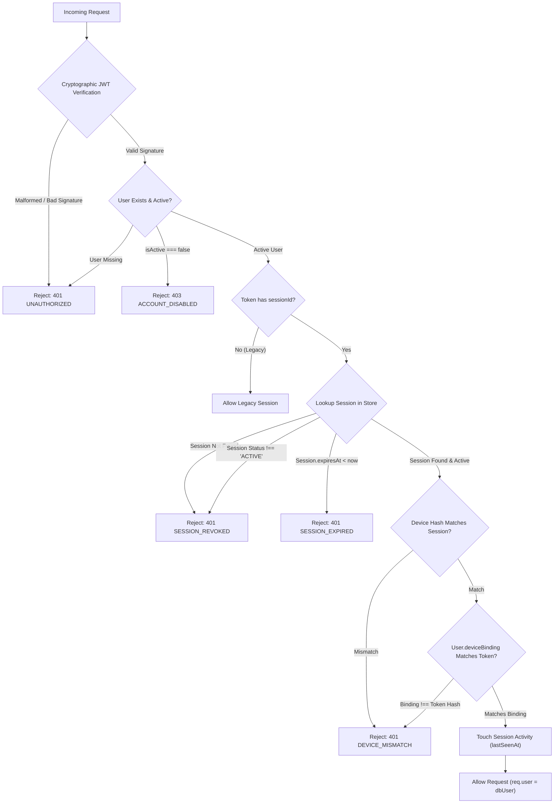

# AIIMS Session Security & Threat Model Report

## 1. Executive Summary

As part of Prompt 3/12, the authentication pipeline was upgraded from stateless JWT tokens to a **stateful, device-bound session validation architecture**. Every incoming authenticated request is validated across cryptographic, temporal, database session state, and device hardware identity layers.

---

## 2. JWT Token Payload Structure

The JWT token now carries both session and device tracking claims:

```json
{
  "userId": "usr-dev-001",
  "email": "learner@aiims.edu",
  "role": "learner",
  "sessionId": "b8beb1d7-e2ab-4c26-afb2-09bf2f95cb50",
  "deviceIdHash": "9f83c605d847343ec7107449df5d521897d25a657acc65137222b7ab5e26c047",
  "iat": 1730553600,
  "exp": 1731158400
}
```

- **`sessionId`:** UUID v4 referencing the authoritative database/memory session record.
- **`deviceIdHash`:** SHA-256 hash of the enrolled client device ID.
- **`exp`:** 7-day token expiration window.

---

## 3. Active Session Middleware Verification Pipeline

In [`Backend/src/middleware/auth.middleware.ts`](file:///c:/Users/divya/OneDrive/Documents/AIIMS/Backend/src/middleware/auth.middleware.ts), `authenticateStudent` and `requireAuth` execute the following verification steps on every request:



---

## 4. Threat Modeling & Attack Scenario Evaluation

| # | Attack Vector | Mechanism Tested | Protection Implemented | Result |
| :--- | :--- | :--- | :--- | :--- |
| **T-01** | **Post-Logout Token Replay** | Attacker intercepts valid JWT and attempts requests after user logs out | `logout` marks session `status: 'REVOKED'` and sets `activeSessionId: null`. Auth middleware checks session status on read. | ✅ **BLOCKED (HTTP 401 `SESSION_REVOKED`)** |
| **T-02** | **Device Spoofing / Token Replay on Device B** | Attacker copies legitimate JWT and sends it from a second computer/phone | Auth middleware cross-references `token.deviceIdHash` with `user.deviceBinding.deviceIdHash`. Any mismatch blocks access. | ✅ **BLOCKED (HTTP 401 `DEVICE_MISMATCH`)** |
| **T-03** | **Simultaneous Concurrent Logins** | Two devices attempt simultaneous login on an unassigned account | Atomic database transitions and event-loop guards ensure only 1 device binds; second request receives `403 ACCOUNT_ACTIVE_ANOTHER_DEVICE`. | ✅ **BLOCKED (1 Wins, 1 Rejected)** |
| **T-04** | **Disabled / Suspended Account Evasion** | Banned or suspended user with active token attempts continued API mutations | Middleware strictly verifies `dbUser.isActive !== false` before validating session status. | ✅ **BLOCKED (HTTP 403 `ACCOUNT_DISABLED`)** |
| **T-05** | **Session Forgery / ID Tampering** | Attacker creates JWT with an arbitrary synthesized `sessionId` | Session lookup in `Session.model.ts` fails to find an authoritative record. | ✅ **BLOCKED (HTTP 401 `SESSION_REVOKED`)** |
| **T-06** | **Expired Session Reuse** | Attacker uses a token past its 7-day expiration | Server-side expiration check marks session `EXPIRED` and returns 401. | ✅ **BLOCKED (HTTP 401 `SESSION_EXPIRED`)** |
| **T-07** | **Unauthorized Device Reset** | Student or evaluator attempts calling `POST /api/admin/users/:userId/device-reset` | Route guarded by `requireAuth` + `requireRole('admin')`. | ✅ **BLOCKED (HTTP 403 `ADMIN_REQUIRED`)** |

---

## 5. Audit Logging Architecture

When an administrator resets a user's device binding via `POST /api/admin/users/:userId/device-reset`:
1. All active sessions for the user are updated to `status: 'REVOKED'`.
2. The user document's `deviceBinding` is transitioned to `UNBOUND`.
3. An audit record is written to `DeviceResetAudit`:
   - `targetUserId`: Affected student/learner ID
   - `adminUserId`: ID of the administrative actor
   - `adminEmail`: Email of the administrator
   - `previousDeviceIdHash`: The hardware hash being unbound
   - `reason`: Justification provided by administrator
   - `resetAt`: Server timestamp
4. A mirrored audit log entry is written to `AuditLog` collection for unified timeline auditing.

