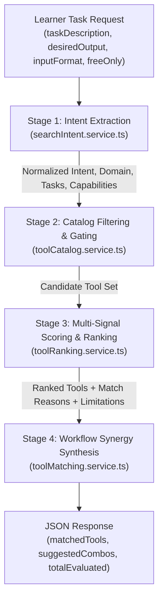

# AIIMS Intelligent Tool Matching Architecture

## 1. Executive Summary & Design Philosophy

The **AIIMS Intelligent Tool Matching Engine** connects learners with optimal AI tools based on their specific task requirements, desired deliverables, input modalities, and economic constraints (free vs commercial).

### Key Architectural Tenets:
1. **Task-First, Not Tool-First:** Learners express what they want to achieve in natural language (e.g., *"Clean tabular CSV data, run regression statistics, and plot charts"*) rather than guessing which tool to search for.
2. **Strict Catalog Grounding (Anti-Hallucination):** Every recommended tool must exist in the verified `ToolCatalogService`. The system will **never** recommend phantom tools, fabricated links, or unsupported products.
3. **Multi-Signal Explainable Scoring:** Recommendations include quantitative match percentages alongside transparent qualitative reasons (`whyMatches`) and trade-offs (`limitations`).
4. **Multi-Tool Composable Workflows:** Complex queries automatically synthesize into structured multi-stage pipelines (e.g., Research $\rightarrow$ Drafting $\rightarrow$ Deck Generation).
5. **Native Integration Transparency:** Clear badges distinguish native AIIMS built-in features (like the Level 2 Clarity Evaluator) from external third-party software.

---

## 2. Verified Tool Catalog Grounding

All recommendations originate strictly from the immutable catalog defined in `Backend/src/services/wallet/toolCatalog.service.ts`:

| Tool ID | Official Name | Primary Domain | Core Capabilities | Free Tier | Native |
|---|---|---|---|---|---|
| `tool-chatgpt` | ChatGPT (GPT-4o) | General Reasoning & Writing | `creative_writing`, `general_reasoning`, `writing`, `analysis` | Yes (Limited) | No |
| `tool-claude` | Claude 3.5 Sonnet | Analysis & Code Synthesis | `nuanced_writing`, `long_context`, `code_generation` | Yes (Limited) | No |
| `tool-cursor` | Cursor IDE | Software Engineering | `agentic_coding`, `code_generation`, `multi_file_composition` | Yes (Trial) | No |
| `tool-copilot` | GitHub Copilot | Inline Developer Autocomplete | `inline_autocomplete`, `contextual_suggestions` | Paid (Free for Students) | No |
| `tool-perplexity` | Perplexity AI | Research & Citation Search | `web_search`, `citation_backed`, `real_time_sources` | Yes (Pro Upgrade) | No |
| `tool-notebooklm` | Google NotebookLM | Document Synthesis & Grounded Q&A | `source_grounded`, `audio_overview`, `multi_source_synthesis` | Yes (100% Free) | No |
| `tool-julius` | Julius AI | Tabular Data & Python Analytics | `data_cleaning`, `statistical_analysis`, `chart_rendering` | Yes (Limited) | No |
| `tool-gamma` | Gamma App | Presentation & Document Layout | `slide_generation`, `visual_formatting`, `deck_creation` | Yes (Credit-based) | No |
| `tool-midjourney` | Midjourney v6 | High-Fidelity Creative Imagery | `image_generation`, `photorealistic_rendering` | Paid Only | No |
| `tool-runway` | Runway Gen-3 Alpha | Video Generation & Motion Synthesis | `text_to_video`, `image_to_video`, `motion_brush` | Yes (Trial) | No |
| `tool-make` | Make (Integromat) | Multi-Service Workflow Automation | `api_integration`, `visual_workflow`, `webhook_triggers` | Yes (1,000 ops/mo) | No |
| `tool-astra` | Astra Assistant | Enterprise RAG & Vector Search | `vector_search`, `rag_orchestration`, `database_indexing` | Yes (Free Tier) | No |
| `tool-v0` | v0 by Vercel | Generative React & UI Prototyping | `react_code_generation`, `tailwind_styling`, `ui_prototyping` | Yes (Daily Credits) | No |

---

## 3. End-to-End Matching Pipeline

The matching request lifecycle executes across four modular pipeline stages:



### Stage 1: Intent Extraction (`searchIntent.service.ts`)
The intent engine extracts structured search criteria from raw learner text:
- **Primary Goal & Domain:** Maps text to domains like Software Coding, Writing, Data Analytics, Presentation Creation, Research, or Automation.
- **Decomposed Tasks:** Identifies granular tasks (e.g., `["Data Ingestion", "Statistical Analysis", "Chart Visualization"]`).
- **Required Capabilities:** Generates capability requirements with weighted importance (e.g., `["data_cleaning", "statistical_analysis", "chart_rendering", "python_execution"]`).
- **Constraints Parsing:** Detects constraints such as offline needs, citation requirements, or free-only preferences.

### Stage 2: Catalog Filtering & Gating
- If `freeOnly: true` is specified, tools without a free tier or student plan are filtered out immediately.
- If `category` or `domain` is specified, non-matching domains receive gating penalties unless their cross-functional capability score exceeds 70%.

### Stage 3: Multi-Signal Scoring Engine (`toolRanking.service.ts`)
Each candidate tool receives a match score from $0$ to $100$ based on five weighted signals:

$$\text{FinalScore} = w_{\text{cap}} S_{\text{cap}} + w_{\text{dom}} S_{\text{dom}} + w_{\text{task}} S_{\text{task}} + w_{\text{price}} S_{\text{price}} + w_{\text{fam}} S_{\text{fam}}$$

1. **Capability Overlap ($S_{\text{cap}}$, Weight: 45%):**
   Calculates semantic, keyword, and morphological overlap between the intent's required capabilities and the tool's verified capabilities.
2. **Domain Alignment ($S_{\text{dom}}$, Weight: 25%):**
   Awards 100 points for exact primary domain match, 60 points for adjacent domains, and 20 points for cross-cutting foundational models.
3. **Task Coverage ($S_{\text{task}}$, Weight: 15%):**
   Measures what fraction of the decomposed task steps can be performed inside this single tool.
4. **Pricing Suitability ($S_{\text{price}}$, Weight: 10%):**
   Awards bonus points for 100% free or generous free tiers; penalizes paid-only tools when budget constraints exist.
5. **Learner Familiarity ($S_{\text{fam}}$, Weight: 5%):**
   Incorporate the learner's existing stack familiarity level (e.g., Daily Driver vs Interested).

### Stage 4: Explainability & Workflow Synthesis
- **Evidence-Backed `whyMatches`:** Generates 2–3 precise bullet points explaining why the tool fits (e.g., *"Native Python kernel executes pandas and regression statistics in-browser"*).
- **Honest `limitations`:** Highlights known boundary conditions (e.g., *"Free tier limits daily query count; complex models require paid subscription"*).
- **Composable Multi-Tool Workflows:** If a task spans multiple capabilities (e.g., research + slide creation), the engine generates a structured multi-tool combo showing step-by-step synergy.

---

## 4. API Specification & Request Examples

### Endpoint
`POST /api/wallet/match`

### Request Headers
- `Content-Type: application/json`
- `aiims_token`: JWT cookie or Bearer token (Authenticated)

### Request Payload (`matchToolSchema`)
```json
{
  "taskDescription": "Clean tabular CSV data, run regression statistics and plot charts",
  "desiredOutput": "Data Analysis & Visualizations",
  "inputFormat": "CSV / Excel Tables",
  "freeOnly": false,
  "category": "Data & Analytics"
}
```

### Response Payload (HTTP 200)
```json
{
  "success": true,
  "query": "Clean tabular CSV data, run regression statistics and plot charts",
  "totalEvaluated": 13,
  "matchedTools": [
    {
      "toolId": "tool-julius",
      "name": "Julius AI",
      "category": "Data & Analytics",
      "matchScore": 61,
      "matchLabel": "Good match",
      "whyMatches": [
        "Native tabular data processing engine with automated schema detection",
        "Executes Python statistical libraries for regression and clustering",
        "Renders publication-quality charts and interactive graphs"
      ],
      "limitations": [
        "Free tier limits compute minutes per month",
        "Large datasets (>100MB) require cloud connector"
      ],
      "pricing": "Free tier (15 messages/mo), $20/mo Pro",
      "officialUrl": "https://julius.ai",
      "isNative": false
    }
  ],
  "suggestedCombos": [
    {
      "workflowName": "Data Research & Visualization Pipeline",
      "suggestedTools": ["Google NotebookLM", "Julius AI", "Gamma App"],
      "synergyDescription": "Extract insights from unstructured docs, perform rigorous tabular stats, and present results in executive decks."
    }
  ]
}
```

---

## 5. Frontend Presentation & User Experience

Implemented in `Frontend/src/screens/wallet/IntelligentToolMatchingSection.tsx`:
- **Interactive Query Bar:** Natural language input with real-time character guidance and debounce.
- **Requirement Chips:** One-click prefill chips for common academic and entrepreneurial workflows:
  - *"Draft academic literature review with APA citations"*
  - *"Investor pitch deck with modern visuals"*
  - *"Full-stack TypeScript React code editor"*
  - *"Clean CSV data and plot regression charts"*
- **Score Indicators:** Color-coded badges indicating match strength:
  - 80%+ : **Excellent Match** (Emerald)
  - 60–79%: **Good Match** (Indigo)
  - 40–59%: **Potential Match** (Amber)
- **Direct Launch:** Official external links open in secure new tabs (`target="_blank"` with `rel="noopener noreferrer"`).

