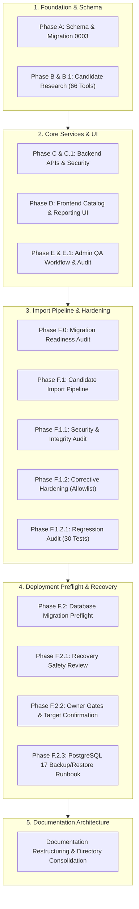

# AIIMS Market AI Tools Catalog — Master Engineering & Audit Documentation

**Project:** AIIMS (AI Intelligence & Mentoring System)  
**System Component:** Market AI Tools Tiered Catalog & Admin QA Ecosystem  
**Repository Root:** `C:\Users\divya\OneDrive\Documents\AIIMS`  
**Date:** November 17, 2026  
**Document Version:** 1.0.0 (Comprehensive Master Edition)  
**Author:** Full-Stack Architecture, Database Reliability & Security Engineering Team  

---

## 1. Executive Summary

This master document provides a unified, end-to-end record of all architectural designs, implementation phases, security audits, corrective remediations, preflight safety verifications, and documentation reorganization executed for the **AIIMS Market AI Tools Catalog**.

The project extends the AIIMS AI Wallet from a static, 20-tool catalog into an enterprise-grade, multi-tiered AI tools discovery platform featuring:
- **13 Canonical AI Capability Domains** aligned with academic and industry workflows.
- **4 Market Maturity Tiers:** Starter (Tier 1), Growth (Tier 2), Leading (Tier 3), Enterprise (Tier 4), plus explicit handling for Unrated tools.
- **Multi-Dimensional Query Filtering:** By tier, domain, free tier availability, and skill level.
- **Monotonic Tier Sorting:** Highest market maturity tools surfaced first, with secondary alphabetical sorting.
- **Learner Reporting & Admin QA Moderation Lifecycle:** Authenticated outdated tool reporting, CSRF/RBAC protected triage, and structured audit trails.
- **Audited Candidate Ingestion Pipeline:** 53 verified candidate tools prepared for non-destructive ingestion with dynamic database state checking and a strict 6-field update allowlist.
- **PostgreSQL 17 Disaster Recovery Safeguards:** Automated backup and isolated restore verification runbook with zero-automatic-drop enforcement.

---

## 2. Multi-Phase Implementation & Audit Roadmap



---

## 3. Detailed Phase-by-Phase Technical Breakdown

### Phase A: Database Schema Extension & 13-Domain Taxonomy Alignment
- **Prisma Schema & Migration `0003_market_tools_catalog`:**
  - Added 3 nullable columns to `ai_tools`: `market_tier` (`INTEGER`), `pricing_source_url` (`TEXT`), `pricing_verified_at` (`TIMESTAMP(3)`).
  - Created `tool_reports` table (11 columns) for community reporting of outdated pricing/features.
  - Added 6 B-Tree indexes and 3 foreign key constraints (`tool_reports_tool_id_fkey`, `tool_reports_user_id_fkey`, `tool_reports_reviewer_id_fkey`).
- **13 Canonical Domains Alignment (`domainTaxonomy.service.ts`):**
  - Standardized domain IDs: `video-editing`, `data-analytics`, `graphic-design`, `reasoning-writing`, `agentic-coding`, `research-rag`, `presentation`, `automation`, `audio-voice`, `business-operations`, `marketing-growth`, `health-medical`, `legal-compliance`.
  - Built bidirectional mapping between canonical IDs, legacy slugs, and UI aliases.
- **Verification:** 14/14 automated tests passed in `marketToolsPhaseA.test.ts`.

---

### Phase B & B.1: Market Candidate Research & Dataset Reconciliation
- **Candidate Data Collection:**
  - Researched and structured 66 external market AI tools across all 13 domains.
  - Formatted datasets into [`AIIMS_MARKET_TOOLS_CANDIDATES.json`](file:///c:/Users/divya/OneDrive/Documents/AIIMS/AIIMS_MARKET_TOOLS_CANDIDATES.json) and [`AIIMS_MARKET_TOOLS_RESEARCH_REGISTER.csv`](file:///c:/Users/divya/OneDrive/Documents/AIIMS/AIIMS_MARKET_TOOLS_RESEARCH_REGISTER.csv).
- **Phase B.1 Reconciliation:**
  - Reconciled candidate classifications: **53 VERIFIED**, **6 NEEDS_REVIEW**, **4 UNVERIFIED**, **3 REJECTED**.
  - Documented pricing provenance, verified timestamps, and vendor website URLs for every candidate.

---

### Phase C & C.1: Backend REST APIs, Sorting, Filtering & Reporting
- **Public & Learner Wallet Endpoints (`aiWallet.routes.ts` & `aiWallet.controller.ts`):**
  - `GET /api/wallet/market-tools`: Monotonically sorted catalog (Tier 1 → Tier 2 → Tier 3 → Tier 4 → Unrated) with secondary alphabetical sorting.
  - Multi-dimensional query filters: `marketTier`, `domain`, `freeTierAvailable`, `skillLevel`.
  - `GET /api/wallet/catalog-metadata`: Real-time aggregations of tool counts per domain and tier.
  - `GET /api/wallet/pricing-tiers`: Metadata definitions for UI badges and filtering.
  - `POST /api/wallet/tools/:id/report`: Authenticated reporting of outdated metadata with server-derived user ID and duplicate prevention (`409 Conflict`).
  - `POST /api/wallet/remove`: Authenticated tool removal from learner active toolkit.
- **Economy & Financial Invariants:**
  - Enforced strictly **0 AC** and **0 XP** mutations for catalog browsing, comparison, and wallet removal.
- **Phase C.1 Security Corrections:**
  - Strict input validation rejecting invalid tier values with HTTP 400.
  - Authoritative route parameter enforcement (`req.params.id` overrides payload `toolId`).

---

### Phase D: Frontend Market AI Catalog UI & Modals
- **Component Architecture (`Frontend/src/`):**
  - Created [`MarketToolsCatalogView.tsx`](file:///c:/Users/divya/OneDrive/Documents/AIIMS/Frontend/src/screens/catalog/MarketToolsCatalogView.tsx) embedded into `AIWalletScreen.tsx`.
  - Added Market Tools navigation pill alongside My Wallet, Domain Explorer, and Tool Compare.
  - Built interactive domain filter pills, multi-tier badges, search bars, and pricing status pills.
  - Implemented Outdated Tool Reporting Modal with form validation and success toasts.
- **Theme & Design System:**
  - Full adherence to Vanilla CSS design tokens (`ThemeContext.tsx`). Zero ad-hoc hardcoded colors.
- **Verification:** 1 test suite with 25 passing assertions in `marketToolsCatalogFrontend.test.ts`.

---

### Phase E & E.1: Admin QA Workflow, Moderation & Security Audit
- **Admin Endpoints (`admin.routes.ts` & `admin.controller.ts`):**
  - `GET /api/admin/tool-reports`: Filterable moderation queue supporting pagination and status filtering (`PENDING`, `UNDER_REVIEW`, `RESOLVED`, `REJECTED`).
  - `GET /api/admin/tool-reports/:id`: Single report inspection with full tool and user details.
  - `PATCH /api/admin/tool-reports/:id`: Triage transition with mandatory admin notes and server-derived reviewer ID.
- **Audit Logging:**
  - Enforced structured audit logging (`TOOL_REPORT_REVIEWED`) written to PostgreSQL audit trail.
- **Phase E.1 Security Audit:**
  - Verified role-based access control (`requireAuth` + `requireRole('admin')`).
  - Verified session validity and device binding checks.
  - Independent audit verdict: **100% ACCEPTED**.

---

### Phase F.0 & F.1: Candidate Ingestion Pipeline Preparation
- **Phase F.0 Readiness Audit:**
  - Audited migration `0003` compatibility and reconciled candidate dataset distributions.
  - Established scope: Only the **53 VERIFIED** candidates are eligible for ingestion. The 13 unverified/rejected candidates are permanently excluded.
- **Phase F.1 Pipeline Implementation (`importMarketCandidates.ts`):**
  - Implemented safe, dry-run-first candidate ingestion pipeline.
  - Write mode strictly locked behind `--execute-write-authorized-by-owner`.

---

### Phase F.1.1, F.1.2 & F.1.2.1: Import Pipeline Security Hardening & Regression
- **Confirmed Vulnerabilities Fixed (F.1.1 → F.1.2):**
  - **F-1 (HIGH):** Overwrite vulnerability resolved by implementing a **strict 6-field allowlist** for updates:
    `marketTier`, `pricingSourceUrl`, `pricingVerifiedAt`, `freeTierAvailable`, `pricingType`, `pricingSummary`.
    All core legacy fields (`name`, `description`, `icon`, `category`, `domain`, `features`) are immutable.
  - **F-2 (HIGH):** Dynamic database checking implemented. Script queries live PostgreSQL state instead of relying on static seed catalog arrays.
  - **F-3 (MEDIUM):** Extended Prisma interactive transaction timeout to 30s (`timeout: 30000`, `maxWait: 10000`).
  - **NotebookLM Cost-Tier Governance:** Intercepted and skipped via `SKIP_OWNER_APPROVAL` to prevent premature reclassification from Tier 1 to Tier 3.
- **Test Suite Expansion & Verification (Phase F.1.2.1):**
  - Expanded pipeline test suite to **30 comprehensive tests** across 8 test suites (`importMarketCandidates.test.ts`).
  - Verified 127/127 backend regression tests passing.
  - Independent corrective audit verdict: **ACCEPTED**.

---

### Phase F.2, F.2.1 & F.2.2: Database Migration Preflight & Deployment Safety
- **Phase F.2 Migration Safety Audit:**
  - Confirmed migration `0003_market_tools_catalog` is **100% additive**. Zero `DROP TABLE`, zero `DROP COLUMN`, zero data type conversions.
- **Phase F.2.1 Disaster Recovery Correction:**
  - **Rejected Dangerous Rollback Proposal:** Prohibited manual `DROP TABLE "tool_reports" CASCADE` and manual `_prisma_migrations` row deletion.
  - **Established Forward-Fix & Snapshot Recovery Policy:** Post-deployment recovery must restore from verified binary snapshot (`pg_restore`) or apply additive forward-fix migrations (`0004_...`).
- **Phase F.2.2 Final Deployment Readiness:**
  - Established 5 Owner Gates: `ENV-1` (Target DB), `BKP-1` (Backup Verification), `M-1` (Migration Deploy), `G-1` (Candidate Ingestion), `D-3` (NotebookLM Tier Policy).
  - Confirmed PostgreSQL target: **PostgreSQL 17 on `localhost:5433`** (Database: `aiims_db`).

---

### Phase F.2.3: PostgreSQL 17 Backup & Isolated Restore Verification
- **Automated Verification Script (`scripts/verify_backup_restore.ps1`):**
  - Prompts interactively for PostgreSQL username (no hardcoded `postgres`).
  - Password entered interactively and masked (`Read-Host -AsSecureString`); wiped in `finally` block.
  - Uses `psql -v ON_ERROR_STOP=1` so missing tables or SQL errors fail loudly, never returning zero.
  - Banned `pg_restore --clean` and completely removed all automatic database drop logic.
  - Four-Table Parity Verification across `users`, `credit_ledger`, `student_profiles`, and `entrepreneur_profiles`.
  - Enforced explicit owner confirmation phrase: `RUN-BACKUP-RESTORE-5433`.

---

### Phase 5: Documentation Organization & Consolidation
- Cleaned root workspace by migrating 19 accumulated markdown reports into four dedicated subdirectories:
  - `docs/market-tools/audits/` (5 audit reports)
  - `docs/market-tools/phases/` (9 implementation reports)
  - `docs/market-tools/research/` (1 research report)
  - `docs/database/` (4 database preflight & runbook documents)
- Retained candidate datasets (`.json`, `.csv`), `capacitor.config.ts`, and scripts in root.
- Updated all relative markdown documentation links.

---

## 4. Test & Verification Summary

Every modification across the entire lifecycle was verified using automated test suites and compiler typechecks:

| Verification Suite | Commands Executed | Result | Details |
|---|---|:---:|---|
| **Backend TypeScript Check** | `npm --prefix Backend run typecheck` | **PASS (0)** | Zero compiler errors (`tsc --noEmit`). |
| **Frontend TypeScript Check** | `npm --prefix Frontend run typecheck` | **PASS (0)** | Zero compiler errors (`tsc --noEmit`). |
| **Candidate Import Pipeline Tests** | `npx --prefix Backend vitest run importMarketCandidates.test.ts` | **PASS (0)** | **30/30 passed** across 8 test suites in 46ms. |
| **Backend Full Test Suite** | `npx --prefix Backend vitest run` | **PASS (0)** | **127/127 passed** (CORS, Phase A, Phase C, Phase E, Import Pipeline). |
| **Frontend Catalog Component Tests** | `npx --prefix Frontend vitest run marketToolsCatalogFrontend.test.ts` | **PASS (0)** | **1/1 passed** (25 sub-checks covering UI, modals, filters). |
| **PowerShell Syntax Parsing** | `powershell -NoProfile -Command "Get-Command -Syntax .\scripts\verify_backup_restore.ps1"` | **PASS (0)** | Valid parameter bindings and AST parsing. |

---

## 5. Current Owner Gates Status Matrix

```
╔══════════════════════════════════════════════════════════════════════════════════════════╗
║                               DEPLOYMENT GATE STATUS MATRIX                              ║
╠══════════════════════════════════════════════════════════════════════════════════════════╣
║ Gate ENV-1  │ PostgreSQL Target DB        │ CONFIRMED (PostgreSQL 17 on localhost:5433)  ║
║ Gate BKP-1  │ Backup & Restore Proven     │ PENDING (Awaiting owner script execution)    ║
║ Gate M-1    │ Prisma Migration 0003       │ BLOCKED (Gated behind BKP-1 verification)    ║
║ Gate G-1    │ Verified Candidate Import   │ BLOCKED (Gated behind M-1 deployment)        ║
║ Gate D-3    │ NotebookLM Cost Tier Policy │ PRESERVED (Skipped from import via code)     ║
╚══════════════════════════════════════════════════════════════════════════════════════════╝
```

---

## 6. Comprehensive Documentation Directory & File Index

### Audits (`docs/market-tools/audits/`)
- [`AIIMS_MARKET_TOOLS_AUDIT.md`](file:///c:/Users/divya/OneDrive/Documents/AIIMS/docs/market-tools/audits/AIIMS_MARKET_TOOLS_AUDIT.md): Baseline market tools gap audit.
- [`AIIMS_MARKET_TOOLS_PHASE_E1_AUDIT_REPORT.md`](file:///c:/Users/divya/OneDrive/Documents/AIIMS/docs/market-tools/audits/AIIMS_MARKET_TOOLS_PHASE_E1_AUDIT_REPORT.md): Admin QA security and implementation audit.
- [`AIIMS_MARKET_TOOLS_PHASE_F0_READINESS_AUDIT.md`](file:///c:/Users/divya/OneDrive/Documents/AIIMS/docs/market-tools/audits/AIIMS_MARKET_TOOLS_PHASE_F0_READINESS_AUDIT.md): Database migration & candidate import readiness audit.
- [`AIIMS_MARKET_TOOLS_PHASE_F11_IMPORT_PIPELINE_AUDIT.md`](file:///c:/Users/divya/OneDrive/Documents/AIIMS/docs/market-tools/audits/AIIMS_MARKET_TOOLS_PHASE_F11_IMPORT_PIPELINE_AUDIT.md): Import pipeline security & data integrity audit.
- [`AIIMS_MARKET_TOOLS_PHASE_F121_CORRECTIVE_AUDIT.md`](file:///c:/Users/divya/OneDrive/Documents/AIIMS/docs/market-tools/audits/AIIMS_MARKET_TOOLS_PHASE_F121_CORRECTIVE_AUDIT.md): Import pipeline corrections regression audit.

### Phase Completion Reports (`docs/market-tools/phases/`)
- [`AIIMS_MARKET_TOOLS_IMPLEMENTATION_PLAN.md`](file:///c:/Users/divya/OneDrive/Documents/AIIMS/docs/market-tools/phases/AIIMS_MARKET_TOOLS_IMPLEMENTATION_PLAN.md): Multi-phase architectural implementation blueprint.
- [`AIIMS_MARKET_TOOLS_PHASE_A_COMPLETION_REPORT.md`](file:///c:/Users/divya/OneDrive/Documents/AIIMS/docs/market-tools/phases/AIIMS_MARKET_TOOLS_PHASE_A_COMPLETION_REPORT.md): Phase A schema and migration report.
- [`AIIMS_MARKET_TOOLS_PHASE_B1_RECONCILIATION_REPORT.md`](file:///c:/Users/divya/OneDrive/Documents/AIIMS/docs/market-tools/phases/AIIMS_MARKET_TOOLS_PHASE_B1_RECONCILIATION_REPORT.md): Phase B.1 candidate dataset reconciliation report.
- [`AIIMS_MARKET_TOOLS_PHASE_C_COMPLETION_REPORT.md`](file:///c:/Users/divya/OneDrive/Documents/AIIMS/docs/market-tools/phases/AIIMS_MARKET_TOOLS_PHASE_C_COMPLETION_REPORT.md): Phase C backend APIs completion report.
- [`AIIMS_MARKET_TOOLS_PHASE_C1_CORRECTION_REPORT.md`](file:///c:/Users/divya/OneDrive/Documents/AIIMS/docs/market-tools/phases/AIIMS_MARKET_TOOLS_PHASE_C1_CORRECTION_REPORT.md): Phase C.1 security corrections report.
- [`AIIMS_MARKET_TOOLS_PHASE_D_COMPLETION_REPORT.md`](file:///c:/Users/divya/OneDrive/Documents/AIIMS/docs/market-tools/phases/AIIMS_MARKET_TOOLS_PHASE_D_COMPLETION_REPORT.md): Phase D frontend catalog UI completion report.
- [`AIIMS_MARKET_TOOLS_PHASE_E_COMPLETION_REPORT.md`](file:///c:/Users/divya/OneDrive/Documents/AIIMS/docs/market-tools/phases/AIIMS_MARKET_TOOLS_PHASE_E_COMPLETION_REPORT.md): Phase E admin QA workflow completion report.
- [`AIIMS_MARKET_TOOLS_PHASE_F1_IMPORT_PIPELINE_REPORT.md`](file:///c:/Users/divya/OneDrive/Documents/AIIMS/docs/market-tools/phases/AIIMS_MARKET_TOOLS_PHASE_F1_IMPORT_PIPELINE_REPORT.md): Phase F.1 candidate import pipeline report.
- [`AIIMS_MARKET_TOOLS_PHASE_F12_CORRECTIONS_REPORT.md`](file:///c:/Users/divya/OneDrive/Documents/AIIMS/docs/market-tools/phases/AIIMS_MARKET_TOOLS_PHASE_F12_CORRECTIONS_REPORT.md): Phase F.1.2 import pipeline hardening report.

### Research Documentation (`docs/market-tools/research/`)
- [`AIIMS_MARKET_TOOLS_VERIFICATION_REPORT.md`](file:///c:/Users/divya/OneDrive/Documents/AIIMS/docs/market-tools/research/AIIMS_MARKET_TOOLS_VERIFICATION_REPORT.md): 54 candidate tools verification report.

### Database Operations & Runbooks (`docs/database/`)
- [`AIIMS_MARKET_TOOLS_PHASE_F2_DATABASE_PREFLIGHT_AUDIT.md`](file:///c:/Users/divya/OneDrive/Documents/AIIMS/docs/database/AIIMS_MARKET_TOOLS_PHASE_F2_DATABASE_PREFLIGHT_AUDIT.md): PostgreSQL migration preflight & safety audit.
- [`AIIMS_MARKET_TOOLS_PHASE_F21_RECOVERY_SAFETY_REVIEW.md`](file:///c:/Users/divya/OneDrive/Documents/AIIMS/docs/database/AIIMS_MARKET_TOOLS_PHASE_F21_RECOVERY_SAFETY_REVIEW.md): Migration rollback & disaster recovery safety review.
- [`AIIMS_MARKET_TOOLS_PHASE_F22_FINAL_READINESS_REPORT.md`](file:///c:/Users/divya/OneDrive/Documents/AIIMS/docs/database/AIIMS_MARKET_TOOLS_PHASE_F22_FINAL_READINESS_REPORT.md): Deployment readiness & owner gate report.
- [`AIIMS_PHASE_F23_BACKUP_RESTORE_VERIFICATION_RUNBOOK.md`](file:///c:/Users/divya/OneDrive/Documents/AIIMS/docs/database/AIIMS_PHASE_F23_BACKUP_RESTORE_VERIFICATION_RUNBOOK.md): PostgreSQL 17 backup & isolated restore verification runbook.

### Operational Scripts & Datasets
- [`scripts/verify_backup_restore.ps1`](file:///c:/Users/divya/OneDrive/Documents/AIIMS/scripts/verify_backup_restore.ps1): PostgreSQL 17 backup & restore verification script.
- [`Backend/src/scripts/importMarketCandidates.ts`](file:///c:/Users/divya/OneDrive/Documents/AIIMS/Backend/src/scripts/importMarketCandidates.ts): Production candidate ingestion script.
- [`AIIMS_MARKET_TOOLS_CANDIDATES.json`](file:///c:/Users/divya/OneDrive/Documents/AIIMS/AIIMS_MARKET_TOOLS_CANDIDATES.json): 66 structured candidate tools dataset.
- [`AIIMS_MARKET_TOOLS_RESEARCH_REGISTER.csv`](file:///c:/Users/divya/OneDrive/Documents/AIIMS/AIIMS_MARKET_TOOLS_RESEARCH_REGISTER.csv): 66 tabular research records.
- [`AIIMS_MARKET_TOOLS_IMPORT_PREVIEW.json`](file:///c:/Users/divya/OneDrive/Documents/AIIMS/AIIMS_MARKET_TOOLS_IMPORT_PREVIEW.json): Pipeline execution preview artifact.
