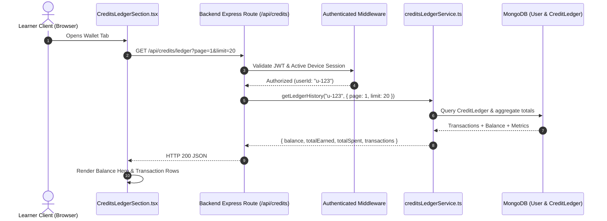

# AIIMS AI Wallet Technical Architecture

## 1. Executive Summary & Design Principles

The **AIIMS AI Wallet** provides an authoritative, tamper-proof, transparent ledger and management interface for AI Credits (AC) within the AIIMS platform. AI Credits function as the platform's computational currency, governing access to token-intensive reasoning models, iterative rubric evaluations in Clarity Labs, and advanced productivity agents.

### Core Architectural Axioms:
1. **Server-Side Authoritative Truth:** The frontend never computes, forecasts, or locally manipulates AC balances. The balance displayed on screen is always retrieved synchronously or reactively from `CreditLedger` and `User.aiimsCredits` via verified backend endpoints.
2. **Dual-Ledger Synchronization:** The user's fast-read balance in `User.aiimsCredits` is kept in strict mathematical parity with the immutable append-only `CreditLedger` collection via atomic MongoDB transactions or atomic fallback operations.
3. **Overdraft & Race Condition Immunity:** Balances cannot go negative under concurrent execution. Deductions utilize conditional atomic atomic operators (`$gte: amount`) ensuring that two concurrent 10 AC requests from a learner with 10 AC result in exactly one success and one `INSUFFICIENT_CREDITS` (HTTP 402) rejection.
4. **Transparent Cost Discovery:** Every action that consumes or grants AC is documented openly in an authoritative platform cost schedule (`GET /api/credits/costs`).
5. **Zero Phantom Tools:** Tool discovery is grounded in a verified catalog of production AI tools with explicit input/output capabilities, pricing models, official documentation URLs, and native platform integration indicators.

---

## 2. Component Architecture & Frontend Structure

The AI Wallet interface is located at `Frontend/src/screens/wallet/AIWalletScreen.tsx` and is divided into focused, accessible subcomponents adhering to AIIMS design tokens.

```
AIWalletScreen (Container & Tab Navigator)
 ├── Tab 1: AI Credits & Authoritative Ledger
 │    └── CreditsLedgerSection.tsx
 │         ├── Authoritative Balance Hero Card (Live AC, Tier, Sync Status)
 │         ├── Action Trigger: "Earn More Credits" modal / Diagnostic link
 │         ├── Quick Metric Tiles (Total Earned, Total Spent, Net Refunds)
 │         ├── Authoritative AC Cost Discovery Table (GET /api/credits/costs)
 │         ├── Honest Payment Gateway Status Banner (Preview / Non-chargeable)
 │         └── Transaction History Ledger (Filterable by Category, Paginated)
 │
 ├── Tab 2: Intelligent Tool Matching
 │    └── IntelligentToolMatchingSection.tsx
 │         ├── Task-First Natural Language Requirement Input
 │         ├── Quick Example Requirement Chips
 │         ├── Desired Output & Format Specifiers
 │         ├── Free Tier / Commercial Filter Toggle
 │         ├── Multi-Signal Ranked Recommendations (with whyMatches, limitations)
 │         └── Composable Multi-Tool Workflow Cards (Synergy pipelines)
 │
 ├── Tab 3: My Tool Stack (Familiarity Tracker & Stack Gaps)
 ├── Tab 4: Full Catalog (Explore all verified tools)
 ├── Tab 5: Task Comparison (Side-by-side model matrix)
 ├── Tab 6: Toolkit Gaps (Learner competency recommendations)
 └── Tab 7: Pipeline Observability (Real-time telemetry & latency benchmarks)
```

### Component Roles & Responsibilities

| Component | Path | Responsibility |
|---|---|---|
| `AIWalletScreen` | `Frontend/src/screens/wallet/AIWalletScreen.tsx` | Main wallet shell, sub-tab routing, global state synchronization, and tab header. |
| `CreditsLedgerSection` | `Frontend/src/screens/wallet/CreditsLedgerSection.tsx` | Displays authoritative server-fetched balance, cost breakdown, transaction log, and low-balance warnings. |
| `IntelligentToolMatchingSection` | `Frontend/src/screens/wallet/IntelligentToolMatchingSection.tsx` | Natural language task matching UI, output format gating, match score badges, and workflow synergy cards. |
| `LearnerContext` | `Frontend/src/context/LearnerContext.tsx` | Global learner state provider exposing `credits`, `stage`, and balance refresh signals across screens. |
| `client.ts` | `Frontend/src/api/client.ts` | Type-safe API client exposing `getCreditsLedger`, `getCreditCosts`, and `matchTools`. |

---

## 3. Data Flow & State Lifecycle



### Invalidation & Real-Time Sync Triggers
1. **Clarity Run Deductions:** When a learner executes a Clarity evaluation, `Level2AITaskLab.tsx` invokes the backend Clarity endpoint which atomically deducts 10 AC. The returned authoritative new balance updates `LearnerContext`.
2. **Diagnostic Assessment Completion:** Completing the Diagnostic Assessment awards +50 AC via `creditsLedgerService.executeTransaction`. The assessment results screen and wallet reflect the updated balance immediately.
3. **Focus Practice Challenge Completion:** Completing timed Easy, Medium, or Hard focus challenges awards +20 AC (Fast Tier) or +15 AC (Normal Tier), while Overtime completions award 0 AC (per Owner Decision 13).
4. **Manual Refresh Action:** The "Refresh Balance" icon button on `CreditsLedgerSection` bypasses client caches and dispatches a forced HTTP request to `/api/credits/ledger`.

---

## 4. UI/UX Specifications & Design System Compliance

- **Surface Tokens:** The wallet leverages standard AIIMS surface variables (`var(--bg-primary)`, `var(--bg-card)`, `var(--border-subtle)`).
- **Hero Card:** Dark gradient elevation (`linear-gradient(135deg, rgba(99, 102, 241, 0.12) 0%, rgba(168, 85, 247, 0.08) 100%)`) with 32px font weight for the AC balance.
- **Low-Balance Warning Banner:** When authoritative balance drops below 10 AC (the threshold for running a Clarity Lab trial), a contextual warning banner illuminates with direct CTA links to Diagnostic Quests and Guided Practice to earn credits.
- **Badge Hierarchy:**
  - `EARN` / `REWARD`: Emerald text on translucent green pill (`rgba(16, 185, 129, 0.15)`).
  - `SPEND` / `DEDUCT`: Rose text on translucent red pill (`rgba(244, 63, 94, 0.15)`).
  - `REFUND`: Amber text on translucent yellow pill (`rgba(245, 158, 11, 0.15)`).
- **Responsive Layout:** Grid layout automatically refactors from a 4-column metrics row to a single column on mobile viewports (< 768px).

---

## 5. Security & Edge-Case Protection

1. **Anti-Tampering:** No endpoint accepts a client-provided balance value. Any attempt to send `{ balance: 5000 }` to `/api/learner/state` is rejected with HTTP 400 (`PROTECTED_FIELD_MODIFICATION`) as established in Prompt 2.
2. **Double-Click Deductions:** Deductions require a unique `idempotencyKey`. Rapid duplicate clicks from the learner client submit the same idempotency key, returning the existing recorded transaction rather than subtracting double credits.
3. **Session Binding Guard:** All wallet transactions require an active, validated device session cookie (`aiims_token` with valid `sessionId`). Hijacked or mismatched device tokens are rejected with HTTP 401.

