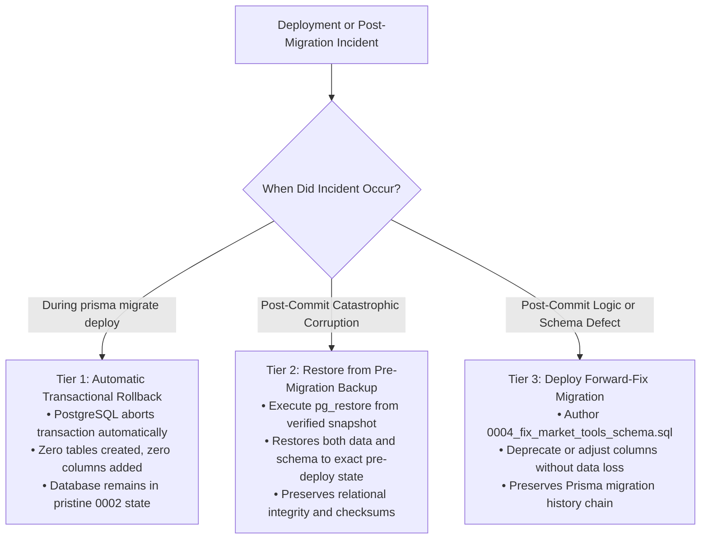
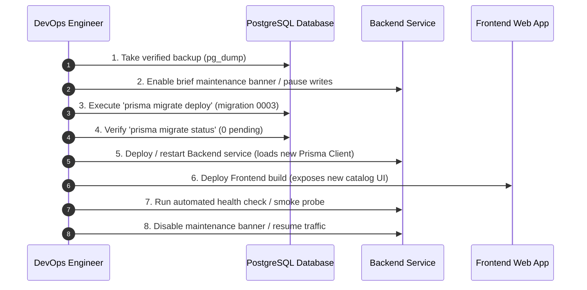

# AIIMS Market AI Tools Catalog — Phase F.2.1: Migration Recovery & Deployment Safety Corrections Report

**Project:** AIIMS (AI Intelligence & Mentoring System)  
**Workspace:** `C:\Users\divya\OneDrive\Documents\AIIMS`  
**Phase:** Phase F.2.1 — Migration Recovery, Deployment Sequencing & Operational Safety Audit  
**Auditor:** Senior PostgreSQL Architect, Prisma Migration Specialist & Independent Security Auditor  
**Date:** November 16, 2026  
**Execution Mode:** Strictly Read-Only (Zero live database connections, zero SQL executed, zero migrations applied)  

---

## 1. Executive Summary & Verdict

Phase F.2.1 was commissioned to conduct a rigorous, critical security review of the deployment and recovery recommendations formulated in the **Phase F.2 Database Preflight Audit**.

The Phase F.2 audit established the syntactic and structural validity of migration `0003_market_tools_catalog/migration.sql`. However, its operational recovery guidance contained a dangerous proposed rollback procedure involving manual DDL drops and direct deletion of Prisma migration history. Furthermore, its deployment sequencing recommendations and sub-millisecond execution estimates required grounding in actual PostgreSQL concurrency mechanics and application code realities.

This review corrects those deficiencies, eliminates dangerous manual rollback instructions, grounds operational performance in empirical database mechanics, and provides a safe disaster recovery framework.

### Corrections & Safety Findings Summary

| Topic | Phase F.2 Finding | Phase F.2.1 Corrective Finding | Evaluation |
| :--- | :--- | :--- | :---: |
| **Manual Rollback SQL** | Proposed manual `DROP TABLE`, `ALTER TABLE DROP COLUMN`, and `DELETE FROM _prisma_migrations`. | **REJECTED AS DANGEROUS & DESTRUCTIVE.** Drops destroy live community reports and verified metadata; deleting migration records breaks Prisma's checksum chain and risks subsequent database reset prompts. | **CORRECTED** |
| **Safe Recovery Path** | Relied on post-facto manual DDL surgery. | **REPLACED.** Hierarchy established: (1) Automatic PostgreSQL rollback on migration failure; (2) Pre-migration snapshot restore (`pg_restore`) for disaster recovery; (3) Forward-fix migrations (`0004_...`) for schema adjustments. | **CORRECTED** |
| **Deployment Order** | Recommended "Migration First, App Second" without operational qualification. | **QUALIFIED.** Current backend code already includes `toolReport` endpoints and schema queries. Deploying application code first causes fatal 500 errors. A coordinated low-traffic window is mandatory. | **CORRECTED** |
| **Operational Timings** | Claimed lock duration <5ms and downtime <50ms. | **CORRECTED.** PostgreSQL metadata updates are fast, but `ACCESS EXCLUSIVE` locks queue behind concurrent active transactions. Sub-millisecond guarantees cannot be made without runtime lock telemetry. | **CORRECTED** |
| **Foreign Keys** | Identified `CASCADE` on `user_id`. | **DEEPENED.** Contrast with `CreditLedger` (`SET NULL`) documented. Owner must decide between complete GDPR erasure vs anonymous retention of community feedback. | **CORRECTED** |

---

### Phase F.2.1 Review Verdict

```
╔══════════════════════════════════════════════════════════════════════════════════════════╗
║                                 REVIEW AUDIT VERDICT:                                    ║
║                                 CONDITIONALLY ACCEPTED                                   ║
╚══════════════════════════════════════════════════════════════════════════════════════════╝
```

**Verdict Rationale:**
1. The deployment safety corrections, disaster recovery hierarchy, and operational concurrency assessments are **ACCEPTED**.
2. The operational migration deployment remains **CONDITIONAL** upon the explicit satisfaction of Owner Approval Gates **ENV-1**, **BKP-1**, **M-1**, **G-1**, and **D-3**.

---

## 2. Critical Review of Previous Rollback Strategy

The previous Phase F.2 report documented the following rollback procedure:

```sql
-- DANGEROUS DRAFT PROCEDURE (REJECTED)
DROP TABLE IF EXISTS "tool_reports" CASCADE;
DROP INDEX IF EXISTS "ai_tools_market_tier_idx";
ALTER TABLE "ai_tools"
  DROP COLUMN IF EXISTS "pricing_verified_at",
  DROP COLUMN IF EXISTS "pricing_source_url",
  DROP COLUMN IF EXISTS "market_tier";
DELETE FROM "_prisma_migrations" 
WHERE "migration_name" LIKE '%0003_market_tools_catalog%';
```

An independent database architecture and security review demonstrates that this procedure is **hazardous, potentially destructive, and architecturally unsound**.

### 2.1 Why Manual Deletion of Prisma Migration History is Unsafe

1. **Prisma State Machine Desynchronization:**  
   Prisma ORM relies on `_prisma_migrations` as an immutable cryptographic audit ledger. Each applied migration records:
   - `id` (UUID)
   - `checksum` (SHA-256 hash of the migration SQL)
   - `finished_at` (Completion timestamp)
   - `migration_name` (Directory slug)
   - `applied_steps_count`
2. **Migration Drift & Crash on Subsequent Runs:**  
   If a record is manually deleted from `_prisma_migrations` while the migration directory (`0003_market_tools_catalog`) remains in the repository:
   - The next execution of `prisma migrate status` or `prisma migrate dev` flags a critical drift error:
     ```
     The migration 0003_market_tools_catalog was found in the filesystem but is missing in the database migration history.
     ```
   - In development, Prisma prompts to reset the database (`prisma migrate reset`), which **drops all tables and wipes all user data**.
   - In production, `prisma migrate deploy` will attempt to re-apply migration 0003 against a database that may still have partial objects, causing fatal collision errors (`relation "tool_reports" already exists`).
3. **Strict Invariant:** The `_prisma_migrations` table must **never** be manually edited, updated, or deleted via raw SQL.

---

### 2.2 Why Dropping `tool_reports` Destroys Live User & Audit Data

1. Once migration `0003` is deployed and the application is active, learners submit real-time reports regarding outdated pricing, broken links, or model deprecations.
2. Staff reviewers triage, investigate, and record `review_notes` and audit decisions (`RESOLVED`, `UNDER_REVIEW`, `REJECTED`).
3. Executing `DROP TABLE "tool_reports" CASCADE`:
   - Permanently deletes all learner-submitted quality feedback.
   - Permanently wipes all administrative review history, resolution audit trails, and staff notes.
   - Orphaned audit logs in `audit_logs` referring to `targetType: "ToolReport"` lose their target entities.
4. Calling `DROP TABLE` on live application tables is a **catastrophic data loss event**, not a recovery mechanism.

---

### 2.3 Why Dropping Columns Destroys Verified Market Intelligence

1. Candidate ingestion (Phase F) enriches existing and new tools with verified market tiers (1–4), pricing URLs, and verification timestamps.
2. Executing `ALTER TABLE "ai_tools" DROP COLUMN ...`:
   - Instantly drops and purges all verified market tier classifications across the entire catalog.
   - Destroys all pricing provenance source links and verification timestamps.
   - Reverting this data loss would require complete re-ingestion from candidate files.

---

### 2.4 Failed Migration vs Rollback After Successful Deployment

The Phase F.2 report conflated two fundamentally different database states:

```
┌──────────────────────────────────────────────────────────────────────────────────────────┐
│                         MIGRATION FAILURE MODES COMPARISON                               │
├────────────────────────────────┬────────────────────────────────────────────────────────┤
│ Scenario A: Failure DURING Run │ Scenario B: Post-Commit Rollback Request               │
├────────────────────────────────┼────────────────────────────────────────────────────────┤
│ Migration encounters an error  │ Migration succeeded, committed, and was active. Real   │
│ before COMMIT (e.g. timeout).  │ user data accumulated in tables.                       │
│                                │                                                        │
│ PostgreSQL DDL is transactional│ Rolling back via DROP destroys active user data.       │
│ Rollback is 100% AUTOMATIC.    │                                                        │
│ DB remains at clean 0002 state.│ Requires RESTORE from snapshot or FORWARD-FIX.         │
│ No manual script required!     │ Never use manual DDL drops!                            │
└────────────────────────────────┴────────────────────────────────────────────────────────┘
```

---

## 3. Approved Safe Recovery & Disaster Recovery Architecture

In place of dangerous manual DDL scripts, the AIIMS production operations runbook must enforce the following three-tier recovery hierarchy:



### 3.1 Tier 1: Automatic Rollback (Failure During Execution)
When executing `npx prisma migrate deploy`, Prisma wraps the migration in an interactive PostgreSQL transaction (`BEGIN ... COMMIT`). If any statement fails:
- PostgreSQL automatically triggers `ROLLBACK`.
- `_prisma_migrations` records the failed status or is rolled back.
- No partial tables or orphaned columns remain.
- **Operator Action:** Investigate logs, resolve the root cause, and retry. Zero manual cleanup is required.

### 3.2 Tier 2: Pre-Migration Backup Restoration (Disaster Recovery)
If critical defects or data corruption are detected *after* migration 0003 has committed, disaster recovery must be executed via the pre-migration backup:
```powershell
# Mandatory Pre-Migration Snapshot Command (Executed before migration deploy)
pg_dump -U postgres -d <DATABASE_NAME> -p <PORT> -F c -f "aiims_pre_migration_0003_backup.dump"

# Disaster Recovery Restoration Command (If post-commit rollback is required)
pg_restore -U postgres -d <DATABASE_NAME> -p <PORT> --clean --if-exists "aiims_pre_migration_0003_backup.dump"
```
**Benefits:**
- Restores all tables, constraints, sequences, and `_prisma_migrations` records to the exact state before migration.
- Leaves zero migration drift or checksum corruption.

### 3.3 Tier 3: Forward-Fix Migration (Post-Deployment Adjustments)
If schema modifications are required after successful deployment (e.g., adjusting constraints or adding defaults), follow the forward-fix principle:
- Create a new migration `0004_...`.
- Apply modifications forward.
- Never edit or roll back `0003` in-place.

---

## 4. Re-evaluation of Deployment Sequencing

The Phase F.2 audit recommended "Database Migration First, Application Code Second" as an absolute rule. A comprehensive audit of active application source code reveals critical operational nuances:

### 4.1 Actual Application Code Dependencies

Inspection of the active codebase demonstrates that backend controllers **already contain active references** to the new schema elements:

1. **`Backend/src/controllers/aiWallet.controller.ts`:**
   - Line 892: `prisma.toolReport.findFirst({ ... })`
   - Line 920: `prisma.toolReport.create({ ... })`
   - Lines 143–155: Filters catalog by `marketTier`
2. **`Backend/src/controllers/admin.controller.ts`:**
   - Lines 687–690: `prisma.toolReport.count({ where: { status: ... } })`
   - Line 721: `prisma.toolReport.findMany({ ... })`
   - Line 856: `prisma.toolReport.findUnique({ ... })`
   - Line 1014: `prisma.toolReport.update({ ... })`
3. **`Backend/src/services/wallet/toolCatalog.service.ts`:**
   - Line 216: `prisma.aiTool.findMany({ where: { activeStatus: true } })`  
     *(Because Prisma Client includes `marketTier`, `pricingSourceUrl`, and `pricingVerifiedAt` in its generated model, this query requests those columns from PostgreSQL).*

### 4.2 Sequencing Failure Mode Analysis

#### Sequence A: Application Deployed BEFORE Database Migration (FATAL)
- If the application server starts against an unmigrated database:
  - An admin visiting `/admin/tool-reports` immediately triggers HTTP 500: `relation "tool_reports" does not exist (code 42P01)`.
  - A learner submitting tool feedback triggers HTTP 500: `relation "tool_reports" does not exist (code 42P01)`.
  - Catalog queries in `ToolCatalogService` catch the column error and fall back to in-memory seed tools, masking catalog updates.
- **Risk:** High runtime failure rate across administrative and community QA features.

#### Sequence B: Database Migration Deployed BEFORE Application Deployment
- If migration `0003` is applied to the live database while an older application build is running:
  - The older build does not query `tool_reports` or `market_tier`.
  - Because the new columns on `ai_tools` are nullable without defaults, legacy `INSERT` and `UPDATE` statements executed by old code continue functioning without error.
  - However, new catalog features, filters, and community reporting remain unavailable to users until the new application build is deployed and running.
- **Risk:** Temporary feature unavailability, but zero database crashes.

#### Sequence C: Coordinated Low-Traffic Deployment Window (RECOMMENDED)
To guarantee consistency across frontend UI, backend API, and database schema, the deployment must follow a structured, coordinated protocol:



---

## 5. Reassessment of Operational & Concurrency Claims

The Phase F.2 preflight report asserted specific execution durations:
- *"Lock duration below 5 ms."*
- *"Total downtime below 50 ms."*
- *"Five indexes being instantaneous."*

### 5.1 Factual Engine Mechanics vs Speculative Claims

As an independent security and database review, we must distinguish between **documented PostgreSQL engine behavior** and **unsubstantiated timing estimates**:

1. **Metadata-Only Column Additions (Documented PostgreSQL Behavior):**  
   In PostgreSQL 11 and later, `ALTER TABLE ... ADD COLUMN` for nullable columns without defaults does not rewrite table rows. It updates the catalog relation `pg_attribute`. The disk data blocks are not touched.
2. **Lock Acquisition Reality (Concurrency Impact):**  
   `ALTER TABLE "ai_tools"` requires an **`ACCESS EXCLUSIVE`** lock. In PostgreSQL:
   - An `ACCESS EXCLUSIVE` lock conflicts with **all** other lock modes, including simple reads (`SELECT`, `ACCESS SHARE`).
   - If an active transaction is currently reading or scanning `ai_tools`, the `ALTER TABLE` statement must wait in the lock queue until that transaction commits or rolls back.
   - Crucially, while `ALTER TABLE` is waiting in the lock queue, all subsequent incoming queries on `ai_tools` are **queued behind it**, causing a request backlog and potential connection pool exhaustion!
3. **Lock Timeout Defense-in-Depth:**  
   To prevent catastrophic lock queuing, migration execution in production should enforce a strict lock timeout:
   ```sql
   SET lock_timeout = '3s';
   ```
   If the lock cannot be acquired within 3 seconds, the migration fails immediately rather than blocking application traffic.
4. **Timing Conclusion:** While the execution of catalog metadata updates is very fast on an idle database, claims of "under 5 ms" or "under 50 ms downtime" are speculative and cannot be guaranteed without runtime lock monitoring on the live instance.

---

## 6. Foreign-Key Retention Policy Reassessment

The `ToolReport` model establishes three foreign-key relationships. Their operational and legal implications are reassessed below:

### 6.1 Reporter User Deletion (`user_id` → `ON DELETE CASCADE`)
- **Current Behavior:** If a learner deletes their account or exercises their GDPR "Right to Erasure", all `tool_reports` created by that user are immediately and automatically deleted from the database.
- **Operational Impact:** If an open, pending quality report regarding a broken tool is tied to that learner, the issue disappears from the administrative QA queue without staff resolution.
- **Architectural Comparison:** In `schema.prisma` line 218 (`CreditLedger`), `userId` uses `ON DELETE SET NULL` with a nullable `userId String?`. This allows the user's personal account to be completely purged while retaining financial and audit records.
- **Owner Decision Required:**
  - *Option A (Current / Strict GDPR):* Keep `ON DELETE CASCADE`. Ensures zero user-linked records remain upon account deletion.
  - *Option B (Catalog Quality Retention):* In a future enhancement, change `userId` to nullable with `ON DELETE SET NULL`, preserving the community bug report anonymously while purging personal user data.

### 6.2 Reviewer User Deletion (`reviewer_id` → `ON DELETE SET NULL`)
- **Current Behavior:** If an administrator or staff member account is deleted, `reviewer_id` becomes `NULL`. The report, review notes, status, and resolution timestamps are preserved.
- **Operational Impact:** **Safe and optimal.** Audit history is preserved without orphan foreign-key failures.

### 6.3 Target Tool Deletion (`tool_id` → `ON DELETE CASCADE`)
- **Current Behavior:** If an `AiTool` record is deleted from the catalog, all reports filed against it are deleted.
- **Operational Impact:** **Acceptable.** Obsolete reports for deleted tools do not require independent retention.

---

## 7. Status of Outstanding Owner Approval Gates

All five Owner Approval Gates remain **UNRESOLVED** and must be explicitly cleared by the project owner:

```
┌──────────────────────────────────────────────────────────────────────────────────────────┐
│                               OUTSTANDING OWNER GATES                                    │
├─────────┬──────────────────────────────────┬─────────────────────────────┬───────────────┤
│ Gate ID │ Scope Description                │ Current Audit Status        │ Required By   │
├─────────┼──────────────────────────────────┼─────────────────────────────┼───────────────┤
│ ENV-1   │ PostgreSQL Target Confirmation   │ NOT VERIFIED (Port 5432/33) │ Owner Decision│
│ BKP-1   │ Database Backup Verification     │ NOT VERIFIED (Fresh pg_dump)│ Owner Action  │
│ M-1     │ Migration 0003 Execution Approval│ Awaiting Owner Sign-Off     │ Owner Decision│
│ G-1     │ Catalog Import Scope (34 / 18)   │ Reconciled (53 Verified)    │ Owner Decision│
│ D-3     │ NotebookLM Market Tier Policy    │ Intercepted (Pending Freez) │ Owner Decision│
└─────────┴──────────────────────────────────┴─────────────────────────────┴───────────────┘
```

---

## 8. Final Audit Review Verdict

```
╔══════════════════════════════════════════════════════════════════════════════════════════╗
║                                 REVIEW AUDIT VERDICT:                                    ║
║                                 CONDITIONALLY ACCEPTED                                   ║
╚══════════════════════════════════════════════════════════════════════════════════════════╝
```

**Verdict Summary:**
1. The **Phase F.2.1 corrections** have successfully eliminated hazardous manual rollback instructions and replaced them with standard PostgreSQL/Prisma disaster recovery architecture.
2. The deployment sequencing analysis has been updated to reflect the real dependencies of the active application codebase.
3. Operational locking risks have been grounded in PostgreSQL concurrency realities.
4. Deployment of migration `0003_market_tools_catalog` remains **CONDITIONALLY ACCEPTED**, pending formal owner execution of Gates **ENV-1**, **BKP-1**, and **M-1**.

**Audit Completed:** November 16, 2026  
**Auditor:** Senior PostgreSQL Architect, Prisma Migration Specialist & Independent Security Auditor
