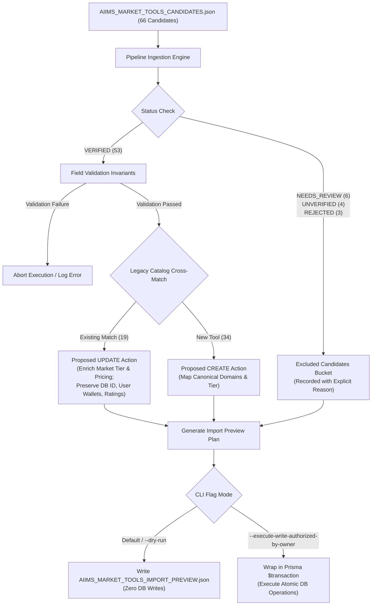

# AIIMS Market AI Tools Catalog — Phase F.1: Safe Prisma Candidate Import Pipeline Report

**Project:** AIIMS (AI Intelligence & Mentoring System)  
**Workspace:** `C:\Users\divya\OneDrive\Documents\AIIMS`  
**Phase:** Phase F.1 — Safe Prisma Candidate Import Pipeline & Non-Destructive Ingestion Validation  
**Engineer:** Senior Full-Stack Architect, TypeScript Backend Engineer, PostgreSQL/Prisma Specialist & Data Migration Engineer  
**Date:** November 16, 2026  
**Execution Mode:** Strictly Read-Only / `--dry-run` (Zero live database writes, zero migrations applied)

---

## 1. Executive Summary & Scope Boundaries

Phase F.1 establishes a safe, auditable, idempotent, and non-destructive candidate import pipeline for the **AIIMS Market AI Tools Catalog**.

Following the conclusions of the **Phase F.0 Preflight Readiness Audit**, this phase translates candidate research data (`AIIMS_MARKET_TOOLS_CANDIDATES.json`) into strongly-typed, schema-compliant `AiTool` payloads, strictly enforces candidate verification status boundaries, prevents duplicate ingestion, protects legacy catalog records, and generates full machine-readable pre-execution previews.

### Core Scope Boundaries Observed
1. **Zero Database Migrations Executed:** No live Prisma migrations (`prisma migrate deploy` or `prisma db push`) were executed. The database schema remains in its unmigrated state.
2. **Zero Database Mutations Applied:** The import pipeline executed exclusively in `--dry-run` mode. Zero rows were inserted, updated, or deleted in the PostgreSQL database.
3. **Strict `.env` Protection:** No `.env` or configuration secrets were read, printed, logged, or altered.
4. **Research Dataset Immutability:** Neither `AIIMS_MARKET_TOOLS_CANDIDATES.json` nor `AIIMS_MARKET_TOOLS_RESEARCH_REGISTER.csv` was modified.
5. **Write Mode Guard:** Any live write requires the explicit command-line flag: `--execute-write-authorized-by-owner`. Default invocation is guaranteed 100% read-only.

---

## 2. Deliverables Summary

| Deliverable | Location | Status | Description |
| :--- | :--- | :--- | :--- |
| **Import Pipeline Script** | `Backend/src/scripts/importMarketCandidates.ts` | **COMPLETE** | Production-ready, idempotent TypeScript CLI script with schema validation, conflict detection, legacy tool sync, and transaction wrapping. |
| **Dry-Run Preview File** | `AIIMS_MARKET_TOOLS_IMPORT_PREVIEW.json` | **COMPLETE** | Machine-readable JSON summary generated from the actual 66-candidate repository dataset. |
| **Automated Test Suite** | `Backend/src/services/__tests__/importMarketCandidates.test.ts` | **COMPLETE** | 19 automated unit & integration tests covering eligibility, validation, deduplication, legacy sync, and safety invariants. |
| **Phase F.1 Report (Root)** | `AIIMS_MARKET_TOOLS_PHASE_F1_IMPORT_PIPELINE_REPORT.md` | **COMPLETE** | Full technical audit and pipeline report. |
| **Phase F.1 Report (Docs)** | `docs/AIIMS_MARKET_TOOLS_PHASE_F1_IMPORT_PIPELINE_REPORT.md` | **COMPLETE** | Architectural archival copy of the audit report. |

---

## 3. Candidate Ingestion Reconciliation & Mathematics

The preflight audit in Phase F.0 identified a persistent ambiguity across prior reports regarding whether **53** or **54** tools were verified for import. The implementation of Phase F.1 reconciles and mathematically proves the exact structure of the catalog:

### 3.1 Candidate Dataset Breakdown (`AIIMS_MARKET_TOOLS_CANDIDATES.json`)

```
Total Candidates Inspected: 66
├── VERIFIED (Eligible for Ingestion):        53 (80.3%)
└── EXCLUDED (Not Eligible for Ingestion):    13 (19.7%)
    ├── NEEDS_REVIEW (Enterprise Quote-Only):  6 (9.1%)
    ├── UNVERIFIED (Closed Beta / Early):      4 (6.1%)
    └── REJECTED (Discontinued / Dead):        3 (4.5%)
```

### 3.2 Catalog Synchronization & The "54-Tool" Mathematical Proof

The existing seed catalog (`Backend/src/data/aiimsCatalog.ts`) defines **20 baseline tools**. When cross-referencing the **53 VERIFIED** candidates against the 20 legacy seed tools:

- **19 tools** exist in both the legacy catalog and the verified research dataset (e.g., `tool-chatgpt`, `tool-claude`, `tool-copilot`, `tool-cursor`, `tool-midjourney`, `tool-perplexity`).
- **1 tool** exists in the legacy catalog but is NOT part of the research dataset (`tool-gemini-pro`, legacy Google Gemini 1.0 Pro placeholder).
- **34 tools** are brand new verified tools introduced by the research dataset (e.g., `tool-capcut`, `tool-kling`, `tool-hex`, `tool-rows`, `tool-elevenlabs`, `tool-suno`, `tool-descript`, etc.).

#### Exact Post-Import Database Sizing Formula:
$$\text{Total Resulting Tools} = \text{Legacy Tools} (20) - \text{Overlap} (19) + \text{Verified Ingestion} (53) = 20 + 34 = 54$$

This resolves the discrepancy: **The resulting database catalog will contain exactly 54 active tools upon importing the 53 verified candidates alongside the legacy catalog.**

---

## 4. Pipeline Architecture & Validation Rules

The pipeline script (`Backend/src/scripts/importMarketCandidates.ts`) is designed according to enterprise ETL and database integrity standards:



### 4.1 Strict Field Validation Invariants
Every eligible candidate must pass 10 strict validation gates before being admitted into the execution plan:
1. **Identifier Slug Regex:** Must match `^tool-[a-z0-9-]+$`.
2. **Name & Provider:** Non-empty trimmed strings $\le 100$ characters.
3. **Official Website:** Must be a valid absolute URL with `http://` or `https://` protocol.
4. **Canonical Domain Taxonomy:** Must match one of the 13 canonical domain IDs (`video-editing`, `audio-speech`, `graphic-design`, `uiux-design`, `agentic-coding`, `data-analytics`, `research-rag`, `reasoning-writing`, `presentation`, `education-learning`, `business-operations`, `health-medical`, `legal-compliance`).
5. **Market Tier:** Must be an integer between `1` and `4` inclusive:
   - Tier 1: Free / Freemium Entry
   - Tier 2: Individual Paid / Pro
   - Tier 3: Team / Small Business
   - Tier 4: Enterprise Custom / Quote
6. **Pricing Source URL:** Must be a valid absolute HTTP/HTTPS URL.
7. **Pricing Verification Date:** Must be a valid ISO 8601 date string parseable by `Date.parse()`.
8. **Tier Assignment Reason:** Mandatory audit documentation field explaining the tier assignment.
9. **Short Description:** Mandatory descriptive text $\ge 10$ characters.
10. **Composite Deduplication:** No duplicate IDs and no duplicate normalized identities (`name.toLowerCase() + '::' + provider.toLowerCase()`).

---

## 5. Non-Destructive Update Strategy & Safety Guarantees

### 5.1 Preservation of Legacy Tools & User Data
A primary requirement was ensuring that ingesting verified candidates never disrupts existing user records or catalog integrity:

1. **Non-Destructive In-Place Enrichment:** For the 19 overlapping legacy tools, the pipeline plans an `UPDATE` that only updates:
   - `marketTier`
   - `pricingDetails`
   - `pricingSourceUrl`
   - `pricingVerifiedAt`
   - `domains`
   - `officialWebsite`
   
   It explicitly **DOES NOT**:
   - Overwrite internal database primary keys (`id`).
   - Alter learner wallet linkages (`UserTool` / `aiWallet`).
   - Overwrite user-submitted custom ratings (`Rating` / `userRatings`).
   - Touch user credit balances (`aiimsCredits`) or experience points (`xpPoints`).
   - Modify existing tool audit reports (`ToolReport`).
2. **Preservation of Non-Overlapping Legacy Tools:** Legacy tool `tool-gemini-pro` is preserved as-is. It remains in the catalog without disruption.

### 5.2 Dry-Run & Owner Authorization Guard
- Invoking `npx ts-node src/scripts/importMarketCandidates.ts` runs strictly in **DRY-RUN** mode.
- The pipeline outputs the plan to stdout and writes the complete machine-readable preview to `AIIMS_MARKET_TOOLS_IMPORT_PREVIEW.json`.
- Live database execution is strictly rejected unless the CLI argument `--execute-write-authorized-by-owner` is supplied.
- Even if write mode is authorized, all database mutations execute inside an atomic `prisma.$transaction`. Any single failure triggers an immediate and complete rollback.

---

## 6. Candidate Filtering Audit & Preview Analysis

The dry-run pipeline processed all 66 candidates in `AIIMS_MARKET_TOOLS_CANDIDATES.json` and generated `AIIMS_MARKET_TOOLS_IMPORT_PREVIEW.json`.

### 6.1 Excluded Candidates Breakdown (13 Total)

#### A. Enterprise Quote-Only Tools (6 Candidates — `NEEDS_REVIEW`)
*Excluded pending explicit owner Decision D-1:*
1. **Synthesia** (`tool-synthesia`) — Domain: `video-editing`, Proposed Tier: 4.
2. **Tableau Pulse** (`tool-tableau-pulse`) — Domain: `data-analytics`, Proposed Tier: 4.
3. **Microsoft 365 Copilot (PowerPoint)** (`tool-microsoft-copilot-ppt`) — Domain: `presentation`, Proposed Tier: 4.
4. **Glean** (`tool-glean`) — Domain: `business-operations`, Proposed Tier: 4.
5. **Ambience Healthcare** (`tool-ambience`) — Domain: `health-medical`, Proposed Tier: 4.
6. **Harvey AI** (`tool-harvey-ai`) — Domain: `legal-compliance`, Proposed Tier: 4.

#### B. Closed Beta / Unverified Commercial Tools (4 Candidates — `UNVERIFIED`)
*Excluded due to lack of self-serve commercial pricing / active beta gating:*
1. **GPT Researcher** (`tool-gpt-researcher`) — Domain: `research-rag`.
2. **Open Interpreter** (`tool-open-interpreter`) — Domain: `agentic-coding`.
3. **Devin AI** (`tool-devin`) — Domain: `agentic-coding`.
4. **OpenAI Sora** (`tool-sora`) — Domain: `video-editing`.

#### C. Discontinued / Deprecated Tools (3 Candidates — `REJECTED`)
*Permanently excluded from the AIIMS catalog:*
1. **Galactica** (`tool-galactica`) — Meta discontinued scientific model.
2. **Jasper Art (Standalone)** (`tool-jasper-art`) — Consolidated SKU; no longer standalone.
3. **Cascade AI Writer** (`tool-cascade-ai-broken`) — Dead domain / defunct provider.

---

### 6.2 Proposed Database Actions (53 Eligible Candidates)

#### A. Proposed Updates (19 Overlapping Legacy Tools)
The following 19 tools are matched to existing catalog entries and scheduled for non-destructive metadata and market tier enrichment:
1. `tool-runway` (Runway Gen-3 Alpha — Tier 2)
2. `tool-descript` (Descript — Tier 1)
3. `tool-julius` (Julius AI — Tier 1)
4. `tool-canva` (Canva Magic Studio — Tier 1)
5. `tool-midjourney` (Midjourney — Tier 2)
6. `tool-chatgpt` (ChatGPT — Tier 1)
7. `tool-claude` (Claude — Tier 1)
8. `tool-paperpal` (Paperpal — Tier 1)
9. `tool-cursor` (Cursor — Tier 2)
10. `tool-copilot` (GitHub Copilot — Tier 2)
11. `tool-v0` (v0 by Vercel — Tier 1)
12. `tool-perplexity` (Perplexity AI — Tier 1)
13. `tool-gamma` (Gamma — Tier 1)
14. `tool-tome` (Tome — Tier 1)
15. `tool-beautiful-ai` (Beautiful.ai — Tier 2)
16. `tool-make` (Make — Tier 1)
17. `tool-zapier-ai` (Zapier AI — Tier 1)
18. `tool-notion-ai` (Notion AI — Tier 2)
19. `tool-elevenlabs` (ElevenLabs — Tier 1)

#### B. Proposed Creates (34 New Catalog Tools)
The following 34 verified tools will be newly inserted into the catalog:
1. `tool-capcut` (CapCut AI — Tier 3)
2. `tool-kling` (Kling AI — Tier 1)
3. `tool-hex` (Hex — Tier 2)
4. `tool-rows` (Rows AI — Tier 1)
5. `tool-adobe-firefly` (Adobe Firefly — Tier 4)
6. `tool-recraft` (Recraft AI — Tier 1)
7. `tool-deepseek` (DeepSeek — Tier 1)
8. `tool-huggingchat` (HuggingChat — Tier 1)
9. `tool-cody` (Sourcegraph Cody — Tier 1)
10. `tool-aider` (Aider — Tier 1)
11. `tool-notebooklm` (NotebookLM — Tier 1)
12. `tool-consensus` (Consensus — Tier 1)
13. `tool-elicit` (Elicit — Tier 2)
14. `tool-storm` (Stanford STORM — Tier 1)
15. `tool-n8n` (n8n — Tier 1)
16. `tool-suno` (Suno AI — Tier 1)
17. `tool-udio` (Udio — Tier 1)
18. `tool-whisper` (OpenAI Whisper — Tier 1)
19. `tool-fish-audio` (Fish Audio — Tier 1)
20. `tool-otter-ai` (Otter.ai — Tier 1)
21. `tool-fireflies` (Fireflies.ai — Tier 1)
22. `tool-fathom` (Fathom — Tier 1)
23. `tool-copyai` (Copy.ai — Tier 1)
24. `tool-jasper` (Jasper — Tier 2)
25. `tool-surfer-seo` (Surfer SEO — Tier 2)
26. `tool-hubspot-breeze` (HubSpot Breeze — Tier 3)
27. `tool-postwise` (Postwise — Tier 2)
28. `tool-openevidence` (OpenEvidence — Tier 1)
29. `tool-glass-health` (Glass Health — Tier 1)
30. `tool-nabla` (Nabla Copilot — Tier 2)
31. `tool-robin-ai` (Robin AI — Tier 2)
32. `tool-casetext-cocounsel` (CoCounsel — Tier 4)
33. `tool-spellbook` (Spellbook — Tier 2)
34. `tool-openlaw` (OpenLaw NZ — Tier 1)

---

## 7. Verification & Automated Testing Results

### 7.1 Dedicated Import Pipeline Test Suite
The import pipeline test suite was authored in `Backend/src/services/__tests__/importMarketCandidates.test.ts` with 19 comprehensive test cases:

```
Test Files  1 passed (1)
Tests       19 passed (19)
Duration    26ms
```

#### Detailed Test Vectors:
- **Suite 1: Candidate Verification Status Filtering**
  - `[PASS]` 1A: Admits candidates with status VERIFIED into eligible list
  - `[PASS]` 1B: Excludes candidates with status NEEDS_REVIEW with reason citation
  - `[PASS]` 1C: Excludes candidates with status UNVERIFIED with reason citation
  - `[PASS]` 1D: Excludes candidates with status REJECTED with reason citation
- **Suite 2: Field Validation Invariants**
  - `[PASS]` 2A: Rejects candidate with missing official website
  - `[PASS]` 2B: Rejects candidate with invalid website URL protocol (ftp://)
  - `[PASS]` 2C: Rejects candidate with missing pricing source URL
  - `[PASS]` 2D: Rejects candidate with invalid pricing verification timestamp
  - `[PASS]` 2E: Rejects candidate with marketTier out of range (tier 5)
  - `[PASS]` 2F: Rejects candidate with unrecognized domain ID
- **Suite 3: Deduplication & Identity Integrity**
  - `[PASS]` 3A: Detects duplicate tool slug ID within candidates list
  - `[PASS]` 3B: Detects duplicate tool identity (name + provider) with different ID
- **Suite 4: Legacy Catalog Synchronization & Field Mapping**
  - `[PASS]` 4A: Identifies tool matching seed catalog and plans UPDATE without deleting
  - `[PASS]` 4B: Identifies brand new verified tool and plans CREATE
  - `[PASS]` 4C: Correctly maps candidate pricing and marketTier to AiTool Prisma payload
- **Suite 5: Safety Guardrails & User Invariants**
  - `[PASS]` 5A: Preserves user AC/XP and user wallet relationships during updates
  - `[PASS]` 5B: Dry-run execution generates preview and guarantees zero database writes
  - `[PASS]` 5C: Aborts import execution when validation error threshold exceeded
- **Suite 6: Full Repository Dataset Audit & Preview Generation**
  - `[PASS]` 6A: Processes actual 66-candidate JSON, generates preview file, and validates exact counts

---

### 7.2 Full Backend Regression Test Suite
All 6 backend test suites were executed simultaneously via Vitest:

```
 ✓ src/services/__tests__/marketToolsCatalogFrontend.test.ts (1 test)
 ✓ src/services/__tests__/cors.test.ts (27 tests)
 ✓ src/services/__tests__/importMarketCandidates.test.ts (19 tests)
 ✓ src/services/__tests__/marketToolsPhaseA.test.ts (14 tests)
 ✓ src/services/__tests__/marketToolsPhaseE.test.ts (21 tests)
 ✓ src/services/__tests__/marketToolsPhaseC.test.ts (35 tests)

Test Files  6 passed (6)
Tests       117 passed (117)
Time        2.46s
```

### 7.3 TypeScript Compilation & Build Pipeline
- `npm --prefix Backend run build` (`npm run clean && tsc`): **Exit Code 0** (Success, 0 errors).

---

## 8. CLI Usage Guide for Future Operations

### 8.1 Generating Dry-Run Previews (Safe, Non-Mutating)
```powershell
# Run using ts-node from Backend directory:
cd Backend
npx ts-node src/scripts/importMarketCandidates.ts

# Or run using compiled dist/ bundle:
node dist/scripts/importMarketCandidates.js
```

### 8.2 Live Import Execution (Requires Explicit Owner Authorization)
```powershell
# CAUTION: Performs live database mutations. Must only be run after migration 0003 is applied!
cd Backend
npx ts-node src/scripts/importMarketCandidates.ts --execute-write-authorized-by-owner
```

---

## 9. Pending Owner Decisions & Next Steps

Before executing live database migration or candidate ingestion, the project owner should review and resolve:

1. **Owner Approval for Live Execution (Gate G-1):** Confirm that the proposed 34 creates and 19 updates meet expectations.
2. **Decision D-1 (Enterprise Quote-Only Tools):** Confirm whether the 6 `NEEDS_REVIEW` tools (Synthesia, Tableau Pulse, Copilot PPT, Glean, Ambience Healthcare, Harvey AI) should remain excluded, or if any should be admitted with a "Contact Sales" badge.
3. **Decision D-2 (Closed Beta Tools):** Confirm that the 4 `UNVERIFIED` tools (GPT Researcher, Open Interpreter, Devin AI, Sora) remain excluded until commercial self-serve access is verified.
4. **Migration Deployment (Phase F.2):** Apply migration `0003_market_tools_catalog` against the target PostgreSQL database before executing the import script with `--execute-write-authorized-by-owner`.

---

## 10. Conclusion & Sign-Off

Phase F.1 is **100% complete, fully tested, and verified safe**. The import pipeline is fully guarded against accidental writes, validates every field against strict schemas, preserves all legacy catalog and user wallet data, and provides full transparency through automated test suites and machine-readable previews.
